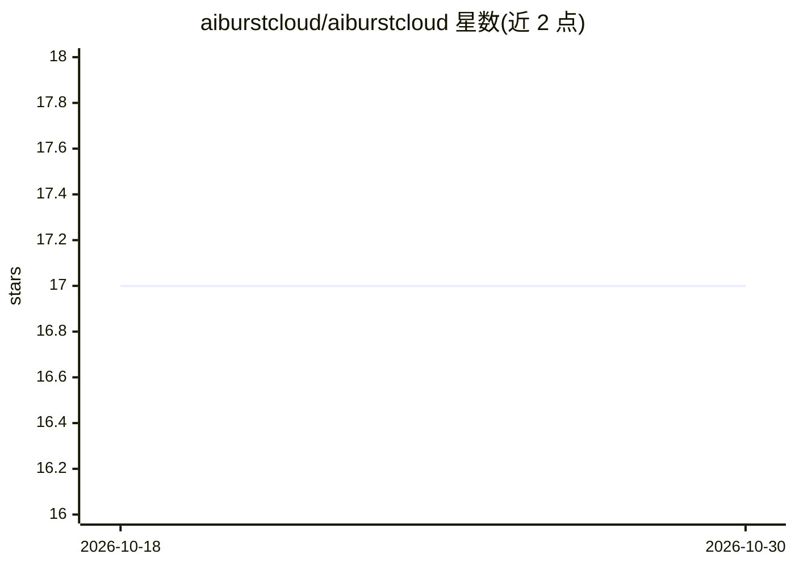

# aiburstcloud/aiburstcloud

⭐ 17 · Python · MIT · 推送 2026-08-13 · [GitHub](https://github.com/aiburstcloud/aiburstcloud) · [官网](https://aiburstcloud.com) · 组织维护

**在本地 GPU 与云端 LLM 后端间自动切换的路由器**

基于 FastAPI 的双模式 LLM 路由器：edge_burst 模式以本地 GPU 为主、过载或宕机时突发至云端；cloud_burst 模式以云端为主、敏感请求回落本地。路由引擎按数据主权（敏感关键词强制本地）、成本（每日云端预算上限）、延迟（队列与延迟阈值）三轴决策，通过 OpenAI 兼容 API 提供服务，响应头携带路由元数据。本地兼容 Ollama、vLLM、llama.cpp、LM Studio、LocalAI，云端支持 RunPod、Modal、Cloud Run 等。支持 pip、Docker、install.sh 及 OpenClaw/Claude Code skill 方式安装。

## 筛选速览

| 维度 | 判定 | 备注 |
|---|---|---|
| AI 角色 | `ai-ecosystem` | LLM/agent 周边工具 |
| 许可风险 | `permissive` | MIT |
| 部署形态 | `self-host` | docker 或自建部署 |
| 模型依赖 | local-ok | 支持本地模型 |
| 硬件要求 | — | 无带数字的原话,不猜 |
| 安装摩擦 | `low` | 无编译、无系统依赖或容器化 |
| 成熟度 | — | 结构信号不足 |

## 能力要点

- edge-first 与 cloud-first 双突发模式，自动故障转移
- 数据主权/成本/延迟三轴路由决策，敏感关键词强制本地
- OpenAI 兼容 API，响应头返回后端选择与原因
- SQLite 持久化预算状态，Prometheus 兼容 /metrics

## 适用场景

- 本地推理为主、高峰期自动扩展到云 GPU
- 受监管数据要求本地处理的同时保留云端算力
- 设置每日云端支出上限以控制推理成本

## 场景标签

`模型网关` · 领域:Agent 开发

## 证据(README 行号)

> L9: **Dual-mode cloud burst LLM router.** Route inference between local GPUs and cloud serverless backends with automati
> L63: User -> [AI Burst Cloud] -> Local GPU (primary, free)

## 星数曲线

2026-10-18 17 → 2026-10-30 17（+0）

---
*卡片 v1 · prompt 1.4 · 生成 2026-10-29 · 置信度 high · 依据 README sha `fcf3c1ba449f` · [字段定义](../../DATASET.md)*
