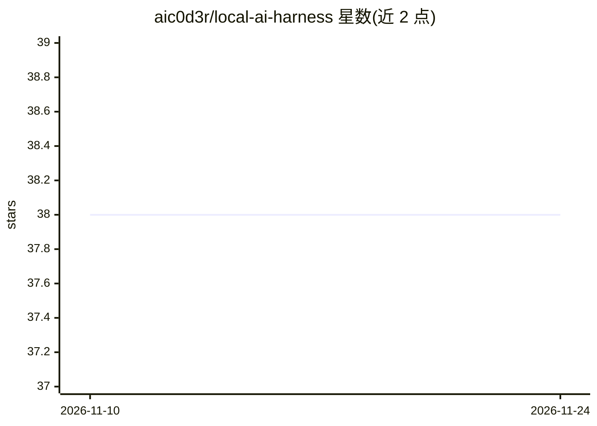

# aic0d3r/local-ai-harness

⭐ 38 · Python · MIT · 推送 2026-11-19 · [GitHub](https://github.com/aic0d3r/local-ai-harness) · [官网](https://aic0d3r.github.io/local-ai-harness/) · 个人维护

**给本地跑编程 agent 的硬件检测与引擎切换工具**

构建在 pi 之上的本地编码 agent 运行环境：检测 GPU 与内存、推荐引擎和模型、按上下文窗口调整限制。通过 ./harness use 在 Strata、llama.cpp、vLLM、Ollama、LM Studio、halogen、gufo、osmos 等引擎间切换，或使用任意 OpenAI 兼容服务及云端模型。附带 token 削减层（符号级代码工具、语义搜索、压缩命令输出）与崩溃恢复检查点。Linux 完整支持，Windows 为 beta（仅 VM 验证），仅在 AMD Strix Halo 上有实测数据。安装为 git clone 后运行 setup.sh。

## 筛选速览

| 维度 | 判定 | 备注 |
|---|---|---|
| AI 角色 | `ai-ecosystem` | LLM/agent 周边工具 |
| 许可风险 | `permissive` | MIT |
| 部署形态 | `None` |  |
| 模型依赖 | local-ok | 支持本地模型 |
| 硬件要求 | — | 无带数字的原话,不猜 |
| 安装摩擦 | `low` | 无编译、无系统依赖或容器化 |
| 成熟度 | `idea` | |

## 能力要点

- 检测 GPU/RAM 并推荐引擎与模型，按上下文窗口设定限制
- 一条命令在 Strata/llama.cpp/vLLM/Ollama/LM Studio 等引擎间切换
- 崩溃后重启并说 continue 即可从检查点恢复
- 多层 token 削减：符号工具、语义搜索、输出压缩、截图降 token

## 适用场景

- 在本地硬件上运行编码 agent 并按机器配置选引擎
- 在多个本地推理引擎或云端模型之间切换
- 断电或崩溃后从中断处继续编程任务

## 场景标签

`编码 Agent` `模型网关` · 领域:Agent 开发

## 证据(README 行号)

> L6: - **Detects your GPU and RAM**, recommends an engine and model, and sizes limits to your context window.
> L7: - **Switches engines:** Strata, llama.cpp, vLLM, Ollama, LM Studio, halogen, gufo, osmos (DeepSeek-V4.1-Flash at 1M 
> L30: Local AI harness: one command, ./harness use, switches the coding agent between Strata, halogen, gufo, llama.cpp, v

## 星数曲线

2026-11-10 38 → 2026-11-24 38（+0）

---
*卡片 v1 · prompt 1.4 · 生成 2026-11-18 · 置信度 high · 依据 README sha `927fa1aa2394` · [字段定义](../../DATASET.md)*
