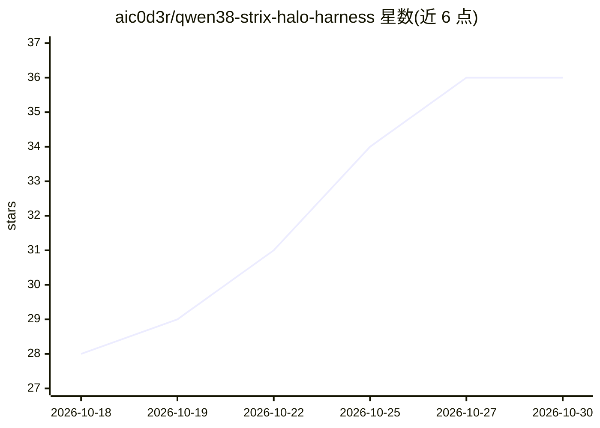

# aic0d3r/qwen38-strix-halo-harness

⭐ 36 · TypeScript · MIT · 推送 2026-10-26 · [GitHub](https://github.com/aic0d3r/qwen38-strix-halo-harness) · [官网](https://github.com/aic0d3r/qwen38-strix-halo-harness/blob/master/docs/local-vs-cloud-model-comparison.md) · 个人维护

**AMD Strix Halo 本地 AI 编程 agent 运行套件（125B 模型）**

面向 Ryzen AI Max+ 395（Strix Halo）设备的本地编程 agent 套件：在 iGPU 上运行 Qwen3.8 Flash-Next 125B（262k 上下文），NPU 承担 prompt 筛查与路由等旁路任务，sidecar 小模型负责提交信息、压缩与仓库图谱，避免污染主模型 prompt 缓存。提供 setup.sh 向导，自动检测并接入 halogen/llama.cpp/vLLM/Ollama/LM Studio 等引擎，兼容任意 OpenAI 兼容引擎，云端可选。含崩溃恢复（进度检查点+continue 续跑）、token 省耗工具（rtk、tool-trim、serena 符号工具、semble 语义检索）与 BENCHMARKS.md 记录的基准。NPU 工具仅限 Strix Halo；halogen 检查点需约 124 GB 下载。

## 筛选速览

| 维度 | 判定 | 备注 |
|---|---|---|
| AI 角色 | `ai-ecosystem` | LLM/agent 周边工具 |
| 许可风险 | `permissive` | MIT |
| 部署形态 | `library` | 以包/库形式分发 |
| 模型依赖 | local-ok | 支持本地模型 |
| 硬件要求 | — | 无带数字的原话,不猜 |
| 安装摩擦 | `medium` | 含编译或系统依赖之一 |
| 成熟度 | — | 结构信号不足 |

## 能力要点

- iGPU 跑 Qwen3.8 125B，NPU 做筛查/路由/检索等旁路任务
- setup.sh 一条命令检测并接入 halogen/llama.cpp/vLLM/Ollama/LM Studio 等引擎
- 崩溃恢复：progress-tracker 检查点，重启后说 continue 续跑
- rtk/tool-trim/serena/semble 等机制压缩上下文与调用开销，结果记录于 BENCHMARKS.md

## 适用场景

- 在 Strix Halo 机器上本地运行大参数编程 agent 处理代码项目
- 切换或接入本地/云端 OpenAI 兼容推理引擎跑编程助手
- 在断电/崩溃后恢复长任务并查看性能基准

## 场景标签

`编码 Agent` · 领域:编码与开发

## 证据(README 行号)

> L3: **Run a 125B-parameter coding agent locally.** Qwen3.8 Flash-Next on the Ryzen AI Max+ 395 iGPU
> L5: summaries. Guided setup for llama.cpp, vLLM, Ollama, LM Studio and more. Built on
> L33: - **Guided setup:** `./setup.sh` detects your engine (halogen, llama.cpp, Strata, vLLM, Ollama,

## 星数曲线

2026-10-18 28 → 2026-10-30 36（+8）

---
*卡片 v1 · prompt 1.4 · 生成 2026-10-25 · 置信度 mid · 依据 README sha `de0923faa538` · [字段定义](../../DATASET.md)*
