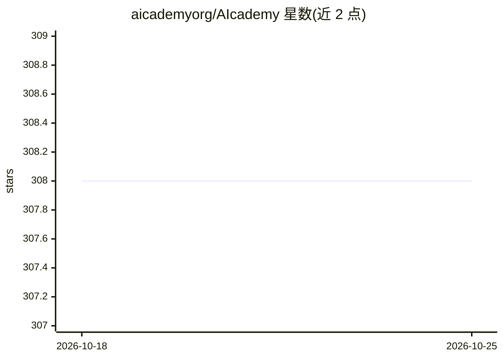

# aicademyorg/AIcademy

⭐ 308 · TypeScript · MIT · 推送 2026-02-18 · [GitHub](https://github.com/aicademyorg/AIcademy) · [官网](https://aicademyorg.netlify.app) · 组织维护

**提供免费 AI 教育的社区及配套网站项目**

AIcademy 是一个面向学习者的免费 AI 教育社区，主题涵盖机器学习、深度学习、生成式 AI、大语言模型、提示工程与数学等。仓库为其网站代码，基于 pnpm 管理依赖，提供开发服务器启动方式（pnpm install、pnpm dev），运行后可访问 localhost:3000。README 未详细描述课程内容与形式。

## 筛选速览

| 维度 | 判定 | 备注 |
|---|---|---|
| AI 角色 | `ai-knowledge` | 知识聚合/清单类 |
| 许可风险 | `permissive` | MIT |
| 部署形态 | `library` | 以包/库形式分发 |
| 模型依赖 | — | README 未给出锁定关系 |
| 硬件要求 | — | 无带数字的原话,不猜 |
| 安装摩擦 | `low` | 无编译、无系统依赖或容器化 |
| 成熟度 | — | 结构信号不足 |

## 能力要点

- 免费 AI 教育社区，主题覆盖机器学习/深度学习/LLM/提示工程等
- 提供 pnpm 安装与开发服务器运行说明

## 适用场景

- 学习 AI 与数据科学相关知识
- 参与社区并贡献网站内容

## 场景标签

`教程课程` · 领域:学习与行业

## 证据(README 行号)

> L3: AIcademy is a friendly community offering free AI education.

## 星数曲线

2026-10-18 308 → 2026-10-25 308（+0）

---
*卡片 v1 · prompt 1.4 · 生成 2026-10-21 · 置信度 low · 依据 README sha `d9881eae70d7` · [字段定义](../../DATASET.md)*
