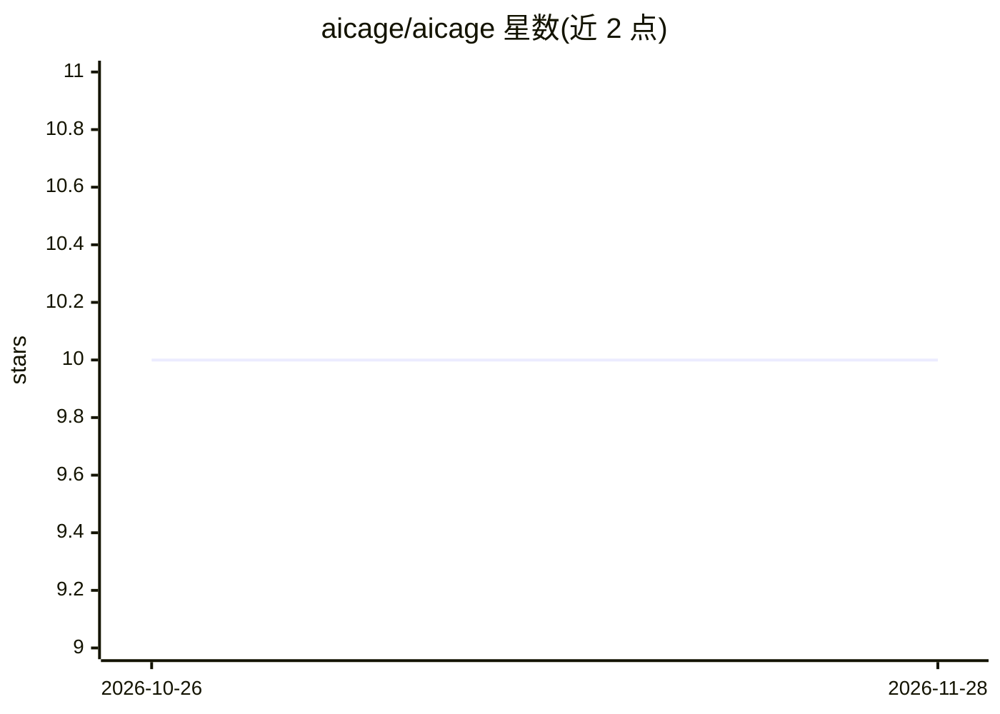

# aicage/aicage

⭐ 10 · Python · Apache-2.0 · 推送 2026-11-27 · [GitHub](https://github.com/aicage/aicage) · 组织维护

**在 Docker 容器中运行 AI 编码代理并隔离其访问范围**

aicage 是一个 CLI 包装器，让用户在容器中运行 AI 编码代理（如 Claude Code、Codex CLI、OpenCode 等），同时继续在本机编辑同一份项目文件。容器提供硬性访问边界：默认仅挂载项目目录，可通过配置菜单设置 bind mounts、Docker 参数、扩展、基础镜像与 Docker socket 开关；支持预构建镜像与自动更新。支持 IDE 集成（VS Code/JetBrains 经 ACP 协议），部分代理需额外安装 ACP bridge。要求本机已安装 Docker；基于 keyring 的认证不可用，推荐文件凭据或 API key。

## 筛选速览

| 维度 | 判定 | 备注 |
|---|---|---|
| AI 角色 | `ai-ecosystem` | LLM/agent 周边工具 |
| 许可风险 | `permissive` | Apache-2.0 |
| 部署形态 | `self-host` | docker 或自建部署 |
| 模型依赖 | — | README 未给出锁定关系 |
| 硬件要求 | — | 无带数字的原话,不猜 |
| 安装摩擦 | `low` | 无编译、无系统依赖或容器化 |
| 成熟度 | — | 结构信号不足 |

## 能力要点

- 内置 11 种 CLI 编码代理，支持自定义添加
- 容器隔离代理访问，默认仅暴露项目文件
- 配置菜单管理 bind mounts、Docker args、扩展与基础镜像
- VS Code/JetBrains IDE 集成（ACP 协议）

## 适用场景

- 在不放开整台电脑权限的前提下让代理编辑项目代码
- 在 IDE 中通过 ACP 插件使用容器化的编码代理
- 为代理追加工具或额外共享目录（扩展机制）
- 自定义代理镜像与基础环境

## 场景标签

`编码 Agent` · 领域:编码与开发

## 证据(README 行号)

> L5: `aicage` runs AI coding agents in containers while you work on the same local project files.
> L12: Running agents in containers gives a hard boundary – with `aicage` the experience stays the same.
> L26: Use one of these builtin CLI agents or

## 星数曲线

2026-10-26 10 → 2026-11-28 10（+0）

---
*卡片 v1 · prompt 1.4 · 生成 2026-11-20 · 置信度 mid · 依据 README sha `0d9d0d4a4d63` · [字段定义](../../DATASET.md)*
