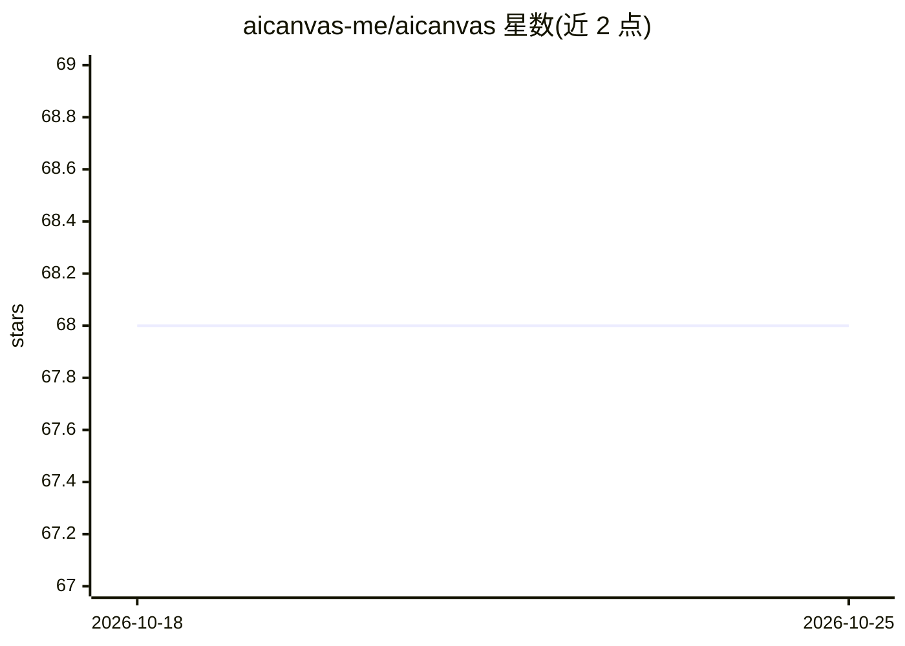

# aicanvas-me/aicanvas

⭐ 68 · TypeScript · MIT · 推送 2026-10-23 · [GitHub](https://github.com/aicanvas-me/aicanvas) · [官网](https://aicanvas.me) · 组织维护

**动效 React 组件注册表：shadcn CLI 或 AI 编辑器经 MCP 安装真实源码**

面向 React 开发者的动画组件与页面区块注册表（80+ 免费组件），以 shadcn registry（@aicanvas）形式提供，通过 npx shadcn add 命令或 MCP 服务器（npx -y @aicanvas/mcp）让 AI 编辑器搜索并安装；组件以真实 React/TypeScript 源码复制进项目而非依赖包。免费库 MIT 许可，Premium 组件/设计系统/模板为专有许可（open-core）。一键安装需免费账号 token，阅读源码无需账号。要求 Tailwind CSS v4、React 19、Framer Motion，默认目标为 Next.js App Router。

## 筛选速览

| 维度 | 判定 | 备注 |
|---|---|---|
| AI 角色 | `ai-enhanced` | 去掉 AI 部分产品仍成立 |
| 许可风险 | `permissive` | MIT |
| 部署形态 | `library` | 以包/库形式分发 |
| 模型依赖 | — | README 未给出锁定关系 |
| 硬件要求 | — | 无带数字的原话,不猜 |
| 安装摩擦 | `low` | 无编译、无系统依赖或容器化 |
| 成熟度 | — | 结构信号不足 |

## 能力要点

- 80+ 免费组件，shadcn CLI 一条命令安装为真实源码
- MCP 服务器（只读）供 Claude Code/Codex/Cursor 等 AI 编辑器搜索并安装组件
- 每组件附平台无关 remix prompt，可在任意 AI 编码工具中重建
- 免费库 MIT；仓库同时包含网站与组件源码，registry JSON 由构建脚本生成

## 适用场景

- 在 Next.js/React 项目中快速引入动画组件与页面区块
- 让 Claude Code/Cursor 等 AI 编辑器经 MCP 自动搜索安装组件
- 通过 remix prompt 让 AI 编码工具按自己的方式重建组件

## 场景标签

 · 领域:前端/UI 组件

## 证据(README 行号)

> L11: A growing collection of animated React components and composed page blocks, installed as real source code in your p
> L74: - **Built for AI workflows.** Install with the shadcn CLI, connect the MCP so your agent installs for you, or hand 
> L99: ## Use it with your AI editor (MCP)

## 星数曲线

2026-10-18 68 → 2026-10-25 68（+0）

---
*卡片 v1 · prompt 1.4 · 生成 2026-10-24 · 置信度 high · 依据 README sha `d4ab909306fb` · [字段定义](../../DATASET.md)*
