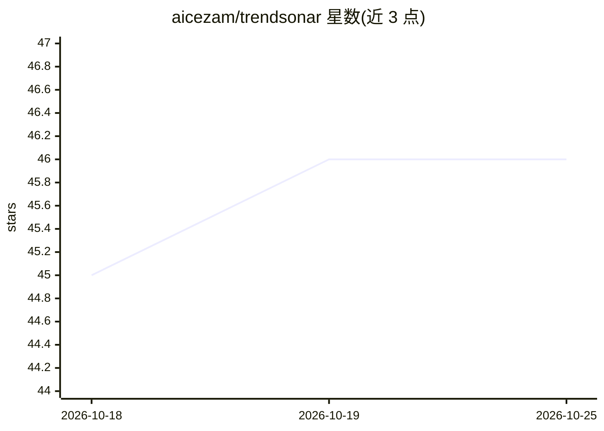

# aicezam/trendsonar

⭐ 46 · Python · MIT · 推送 2026-08-26 · [GitHub](https://github.com/aicezam/trendsonar) · [官网](https://ainews.izam.cn) · 个人维护 · 中文 README

**新闻热点聚合与舆情分析系统，自动聚类去重生成报告**

自托管的新闻舆情 Web 工具：从 RSS/XML/JSON 等配置的新闻源持续抓取内容，用 Crawl4AI/Playwright 补抓正文，结合 Embedding 相似度与大模型（OpenAI-compatible API）完成聚类去重、摘要、分类、情感分析、关键词实体提取，自动发现并生成专题时间轴与趋势仪表盘，产出综合/关键词报告，并基于 PydanticAI 提供带 13 个内置工具的新闻智能体问答。支持主力/备用模型按功能路由。README 提示分析质量依赖新闻源与数据积累时间，初始运行数据少时聚类与报告效果有限。

## 筛选速览

| 维度 | 判定 | 备注 |
|---|---|---|
| AI 角色 | `ai-native` | 本体是模型或模型工具 |
| 许可风险 | `permissive` | MIT |
| 部署形态 | `self-host` | docker 或自建部署 |
| 模型依赖 | — | README 未给出锁定关系 |
| 硬件要求 | — | 无带数字的原话,不猜 |
| 安装摩擦 | `low` | 无编译、无系统依赖或容器化 |
| 成熟度 | — | 结构信号不足 |

## 能力要点

- Embedding 相似度+AI 核验实现多来源事件去重聚合
- 专题自动发现、时间轴、趋势仪表盘与流式 AI 报告
- 基于 PydanticAI 的新闻智能体，支持自定义 HTTP 工具
- 主力/备用模型按功能模块（摘要/情感/聚类/报告等）路由

## 适用场景

- 搭建个人或团队内部的行业动态观察台
- 跟踪公共事件进展并生成每日热点简报
- 通过自然语言对话检索本地新闻库并生成关键词报告

## 场景标签

`网页抓取` `数据分析` · 领域:效率与自动化

## 证据(README 行号)

> L5: TrendSonar 是一个面向新闻热点聚合、事件去重、专题追踪、舆情报告和新闻智能体问答的 Web 工具。它会从配置的新闻源中持续抓取内容，结合 Embedding、OpenAI-compatible 大模型、Crawl4AI/P
> L61: - 基于 PydanticAI 构建新闻智能体，支持连续对话和工具调用事件流。

## 星数曲线

2026-10-18 45 → 2026-10-25 46（+1）

---
*卡片 v1 · prompt 1.4 · 生成 2026-10-25 · 置信度 mid · 依据 README sha `e1ff6c36c20e` · [字段定义](../../DATASET.md)*
