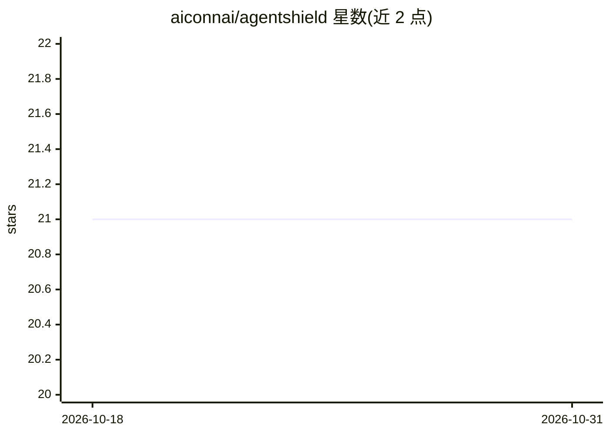

# aiconnai/agentshield

⭐ 21 · Rust · NOASSERTION · 推送 2026-10-29 · [GitHub](https://github.com/aiconnai/agentshield) · [官网](https://aiconnai.github.io/agentshield/) · 组织维护

**给 AI agent/MCP 开发团队的离线 Rust 安全扫描引擎**

面向构建工具型 AI agent 的团队的静态安全分析工具：将 MCP、CrewAI、LangChain/LangGraph、Cursor Rules、GPT Actions 等 11 个框架/客户端家族归一化为统一 IR，检测命令注入、凭据外泄、SSRF、不安全文件访问、运行时装包与提示注入面。提供过程间污点分析、37 条内置规则与 YAML 自定义规则、一键修复、MCP stdio/HTTP/SSE 运行时代理、SARIF/HTML 输出。以 CLI、GitHub Action、VS Code 扩展、Python SDK 与 Rust 库形式分发，100% 离线运行，源码不出本机。当前版本线 1.0.2。

## 筛选速览

| 维度 | 判定 | 备注 |
|---|---|---|
| AI 角色 | `ai-ecosystem` | LLM/agent 周边工具 |
| 许可风险 | `permissive` | NOASSERTION |
| 部署形态 | `self-host` | docker 或自建部署 |
| 模型依赖 | — | README 未给出锁定关系 |
| 硬件要求 | — | 无带数字的原话,不猜 |
| 安装摩擦 | `low` | 无编译、无系统依赖或容器化 |
| 成熟度 | — | 结构信号不足 |

## 能力要点

- 11 个 agent 框架/客户端家族归一化为统一 IR 扫描
- Python/TypeScript 过程间跨函数污点分析
- 37 条内置规则 + YAML 自定义规则引擎，`agentshield fix` 自动修复
- MCP stdio/HTTP/SSE 运行时代理，实时检查工具调用并脱敏泄露的密钥

## 适用场景

- 把 Claude Desktop/Cursor 接入新 MCP 服务器前先扫描其风险
- 在 CI（GitHub Action + SARIF）中拦截含命令注入或凭据外泄的 agent 工具代码
- 本地开发时用 VS Code 扩展获得行内安全提示与一键修复
- 用运行时代理实时检查 MCP 工具调用并脱敏密钥

## 场景标签

`网络安全` `代码审查` · 领域:编码与开发

## 证据(README 行号)

> L21: AgentShield is an offline, high-performance Rust security engine for teams shipping tool-enabled AI agents across t
> L25: AgentShield runs as a CLI, GitHub Action, VS Code extension, or Rust library. It operates 100% offline, keeping sou
> L31: |Scanner surface|Normalizes 11 framework/client families into one IR: MCP, OpenClaw, Hermes Agent, CrewAI, LangChai

## 星数曲线

2026-10-18 21 → 2026-10-31 21（+0）

---
*卡片 v1 · prompt 1.4 · 生成 2026-10-28 · 置信度 high · 依据 README sha `6845436c7296` · [字段定义](../../DATASET.md)*
