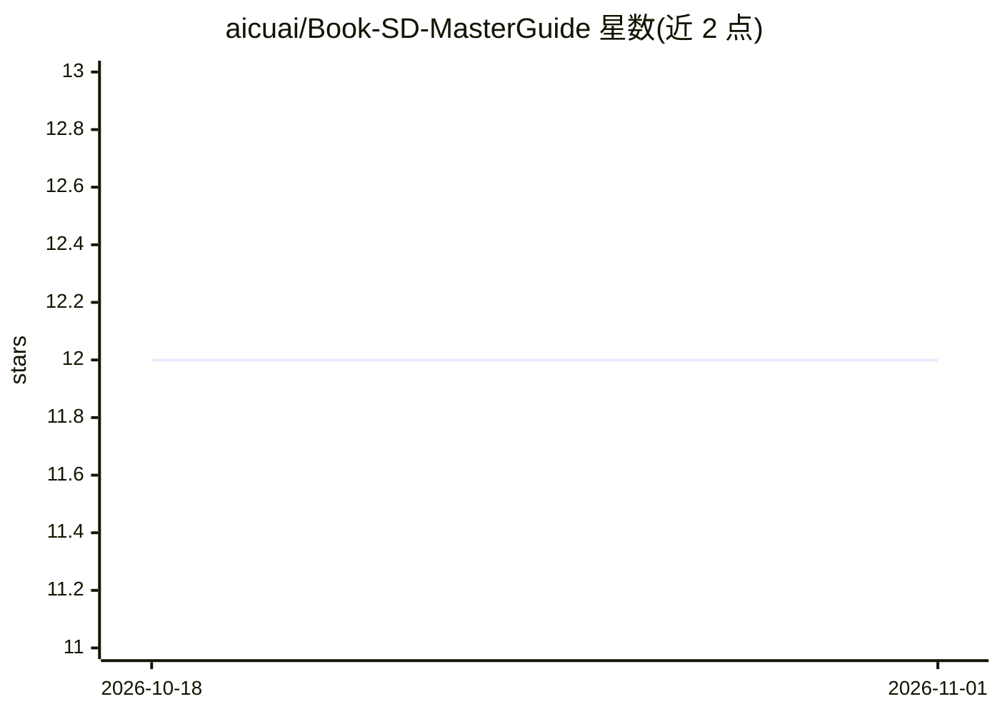

# aicuai/Book-SD-MasterGuide

⭐ 12 · Jupyter Notebook · 推送 2026-09-24 · [GitHub](https://github.com/aicuai/Book-SD-MasterGuide) · [官网](https://comfy.aicu.ai/) · 组织维护

**《ComfyUI Master Guide》书籍配套支持仓库**

为 2025 年 5 月 8 日出版的《ComfyUI Master Guide》（ComfyUI 紫本）提供支持的内容仓库，由 aicuai 维护，README 仅含书籍出版信息与关联链接（j.aicu.ai/comfysb）。属于书籍配套资源仓库，面向该书读者提供延伸资料入口，未展示代码或安装内容。

## 筛选速览

| 维度 | 判定 | 备注 |
|---|---|---|
| AI 角色 | `ai-knowledge` | 知识聚合/清单类 |
| 许可风险 | `none` | — |
| 部署形态 | `None` |  |
| 模型依赖 | — | README 未给出锁定关系 |
| 硬件要求 | — | 无带数字的原话,不猜 |
| 安装摩擦 | `low` | 无编译、无系统依赖或容器化 |
| 成熟度 | — | 结构信号不足 |

## 能力要点

- 《ComfyUI Master Guide》（紫本）的官方支持仓库
- 提供书籍关联链接（j.aicu.ai/comfysb）

## 适用场景

- 购买或阅读该书的读者查找配套资源
- 了解 ComfyUI 相关书籍出版信息

## 场景标签

 · 领域:AI 生成艺术/教学资料

## 证据(README 行号)

> L3: ## Book [ComfyUI Master Guide]
> L5: こちらはComfyUI マスターガイド (#ComfyUI紫本) サポートリポジトリです

## 星数曲线

2026-10-18 12 → 2026-11-01 12（+0）

---
*卡片 v1 · prompt 1.4 · 生成 2026-11-01 · 置信度 mid · 依据 README sha `4b29ad6812b4` · [字段定义](../../DATASET.md)*
