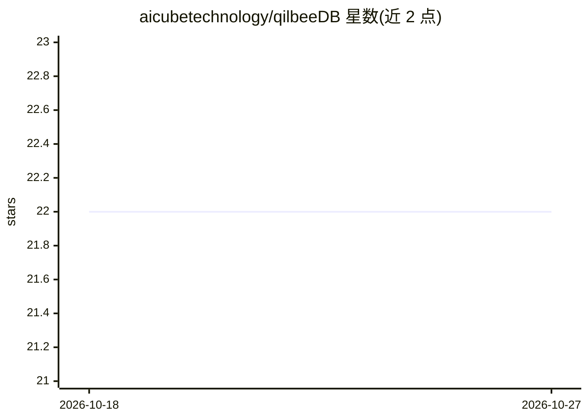

# aicubetechnology/qilbeeDB

⭐ — · [GitHub]() · 组织维护

**面向 AI agent 记忆的 Rust 图数据库，支持自托管**

QilbeeDB 是用 Rust 编写的图数据库，为 AI agent 提供持久记忆、显式图关系、带鉴权的范围检索与证据绑定的程序性知识存储。可通过 QilbeeDB 托管平台（api.qilbeedb.io）或 Docker 自托管使用。嵌入向量留在数据库外部，由应用提供 provider/模型/维度信息，支持 BM25、余弦、混合与图辅助四种检索打分。当前版本 0.14.0，Cypher 支持不完整，Bolt 为占位符，Neo4j 兼容性未确立，混合与图辅助排序为实验性可选功能。

## 筛选速览

| 维度 | 判定 | 备注 |
|---|---|---|
| AI 角色 | `ai-ecosystem` | LLM/agent 周边工具 |
| 许可风险 | `none` | — |
| 部署形态 | `self-host` | docker 或自建部署 |
| 模型依赖 | — | README 未给出锁定关系 |
| 硬件要求 | — | 无带数字的原话,不猜 |
| 安装摩擦 | `low` | 无编译、无系统依赖或容器化 |
| 成熟度 | `idea` | |

## 能力要点

- 持久 agent 记忆：幂等写入、条件修订、溯源、审查与过期
- 嵌入在外部生成，支持至 32,768 维向量与四种检索打分方式
- 能力与作用域的凭证授权体系（轮换/撤销/私有主体）
- Docker 自托管或托管平台两种使用方式

## 适用场景

- 为 AI agent 提供可持久化、可审计的记忆与知识存储
- 需要带证据绑定的程序性知识管理的自动化系统
- 企业内自托管 agent 记忆数据库并通过作用域凭证管控访问

## 场景标签

`Agent 记忆` · 领域:Agent 开发

## 证据(README 行号)

> L11: QilbeeDB is a Rust database for durable agent memory, explicit graph relations,
> L60: Embeddings stay outside the database. Supply provider, model, immutable revision

## 星数曲线

2026-10-18 22 → 2026-10-27 22（+0）

---
*卡片 v1 · prompt 1.4 · 生成 2026-10-27 · 置信度 high · 依据 README sha `356a9524213d` · [字段定义](../../DATASET.md)*
