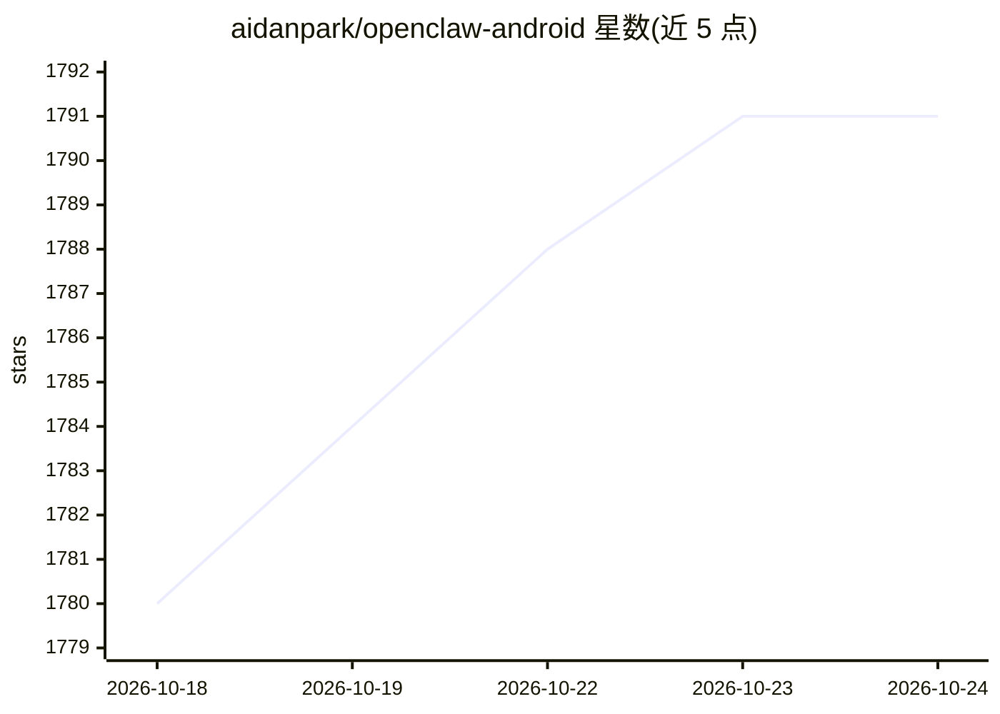

# aidanpark/openclaw-android

⭐ 1,790 · Kotlin · MIT · 推送 2026-10-14 · [GitHub](https://github.com/aidanpark/openclaw-android) · 个人维护 · 中文 README

**在 Android 上免 proot 一条命令安装运行 OpenClaw 的工具**

面向希望在旧手机或低功耗设备上自托管 OpenClaw agent 网关的用户：通过安装 glibc 动态链接器（ld.so）替代完整 Linux 发行版，把约 1-2GB 的 proot-distro 方案压缩到约 200MB，一条 curl 命令完成安装（3-10 分钟）。安装器自动处理路径转换、无 systemd 运行、官方 Node.js arm64 打包等 Termux 兼容问题，并提供 `oa` 命令行管理更新、备份与可选工具（code-server、OpenCode、Claude Code/Gemini CLI/Codex CLI 等）。另有独立 Claw App（APK），内置终端与 WebView 面板，不依赖 Termux。要求 Android 7.0+ 与约 2GB 空闲存储，网关默认监听 18789 端口。

## 筛选速览

| 维度 | 判定 | 备注 |
|---|---|---|
| AI 角色 | `ai-ecosystem` | LLM/agent 周边工具 |
| 许可风险 | `permissive` | MIT |
| 部署形态 | `desktop` | 安装包/桌面程序 |
| 模型依赖 | — | README 未给出锁定关系 |
| 硬件要求 | — | 无带数字的原话,不猜 |
| 安装摩擦 | `low` | 无编译、无系统依赖或容器化 |
| 成熟度 | — | 结构信号不足 |

## 能力要点

- 免 proot-distro，仅装 glibc 动态链接器即运行标准 Linux 二进制，占用约 200MB
- 单命令安装，自动完成路径转换、无 systemd 配置与 Node.js arm64 打包
- 独立 Claw App（APK）内置终端、WebView 面板与 7 步可视化安装
- `oa` CLI 支持更新、备份/恢复、可选工具安装，更新前自动做数据备份

## 适用场景

- 把闲置 Android 手机改造成低功耗自托管 agent 网关设备
- 在家庭网络中运行 OpenClaw 并从 PC 通过 SSH/仪表盘管理
- 不想装完整 Linux 发行版、希望在 Termux 里直接跑 OpenClaw

## 场景标签

`AI 助手` · 领域:对话与助手

## 证据(README 行号)

> L17: The standard approach to running OpenClaw on Android requires installing proot-distro with Linux, adding 700MB-1GB 
> L68: 1. **glibc environment** — Installs the glibc dynamic linker (via pacman's glibc-runner) so standard Linux binaries
> L80: 4. Install OpenClaw — one command

## 星数曲线

2026-10-18 1,780 → 2026-10-24 1,791（+11）

---
*卡片 v1 · prompt 1.4 · 生成 2026-10-21 · 置信度 mid · 依据 README sha `4090d6097e4d` · [字段定义](../../DATASET.md)*
