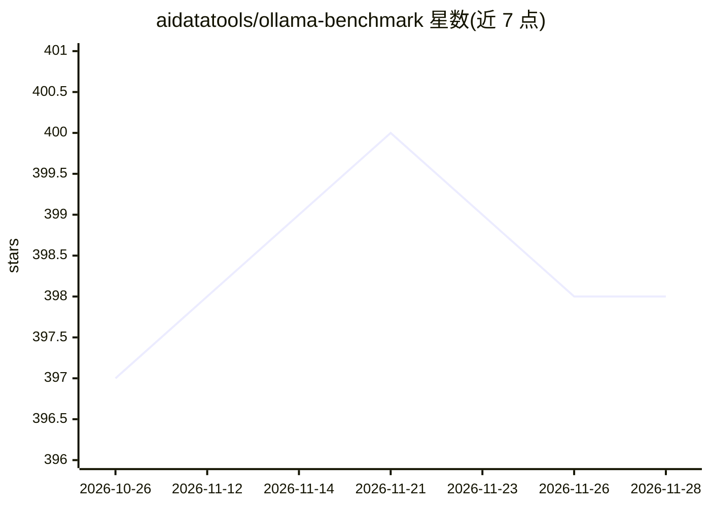

# aidatatools/ollama-benchmark

⭐ 398 · Python · MIT · 推送 2026-10-27 · [GitHub](https://github.com/aidatatools/ollama-benchmark) · [官网](https://llm.aidatatools.com/) · 个人维护

**面向本地 LLM 用户的 Ollama 吞吐量基准测试 CLI**

跨平台 CLI 工具，通过 Ollama 测量本地 LLM 的 tokens-per-second 吞吐量。按检测到的内存大小自动拉取相应规模的测试模型（2B 到 20B 档位），支持自定义 YAML 基准模型清单，可将系统信息与基准结果发送到远程服务器（--no-sendinfo 可关闭），也可指定自建 Ollama 可执行文件路径运行。需预先安装可用的 Ollama，Python 3.10 以上。

## 筛选速览

| 维度 | 判定 | 备注 |
|---|---|---|
| AI 角色 | `ai-ecosystem` | LLM/agent 周边工具 |
| 许可风险 | `permissive` | MIT |
| 部署形态 | `library` | 以包/库形式分发 |
| 模型依赖 | local-ok | 支持本地模型 |
| 硬件要求 | — | 无带数字的原话,不猜 |
| 安装摩擦 | `low` | 无编译、无系统依赖或容器化 |
| 成熟度 | — | 结构信号不足 |

## 能力要点

- 按本机内存自动选择并拉取测试模型
- 支持 YAML 自定义基准模型清单
- 可选上报系统信息与基准结果
- 可指定自建 Ollama 可执行文件路径运行

## 适用场景

- 测一下自己机器上跑各本地模型的 tokens/s
- 换硬件前后对比本地推理吞吐
- 用自定义清单测试自己部署的模型

## 场景标签

`模型评测` · 领域:评测与运维

## 证据(README 行号)

> L3: LLM Benchmark for Throughput via Ollama (Local LLMs)
> L5: Measure how fast your local LLMs _really_ are—with a simple, cross-platform CLI tool that tells you the tokens-per-s
> L71: On Windows, Linux, and macOS, it will detect memory RAM size to first download required LLM models.

## 星数曲线

2026-10-26 397 → 2026-11-28 398（+1）

---
*卡片 v1 · prompt 1.4 · 生成 2026-11-25 · 置信度 high · 依据 README sha `0b572aaaa9ea` · [字段定义](../../DATASET.md)*
