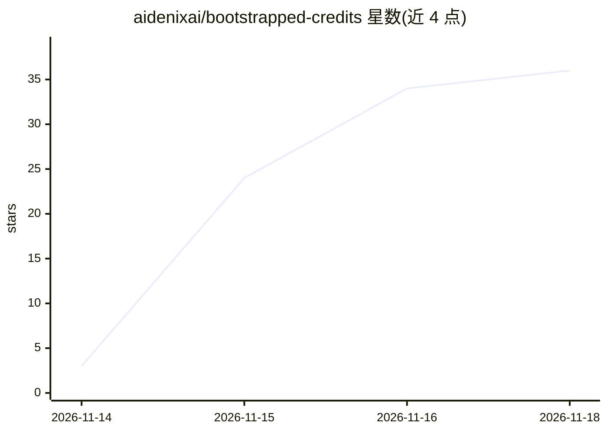

# aidenixai/bootstrapped-credits

⭐ 36 · Python · NOASSERTION · 推送 2026-11-16 · [GitHub](https://github.com/aidenixai/bootstrapped-credits) · [官网](https://aidenix.com) · 组织维护

**给无融资初创的云与 AI 信用额度申请清单**

一份 awesome list，收录面向自筹资金（bootstrapped）公司的云服务与 AI 模型创业信用额度计划：按 AI 模型、服务器存储、增长工具、免申请免费层分类列表，每行标注额度、有效期、是否支持 Claude/GPT/开源模型、维护者实际到手金额与核验日期。维护者是一家自筹资金的数据公司，披露自己以 $0 融资获得 $30,500 额度，并给出申请顺序建议、不可用计划名单与 referral 转售 API key 风险提示。不提供软件，纯信息清单。

## 筛选速览

| 维度 | 判定 | 备注 |
|---|---|---|
| AI 角色 | `ai-knowledge` | 知识聚合/清单类 |
| 许可风险 | `none` | NOASSERTION |
| 部署形态 | `None` |  |
| 模型依赖 | — | README 未给出锁定关系 |
| 硬件要求 | — | 无带数字的原话,不猜 |
| 安装摩擦 | `low` | 无编译、无系统依赖或容器化 |
| 成熟度 | — | 结构信号不足 |

## 能力要点

- 按类别整理各创业信用计划的额度与有效期，逐行标注核验日期
- 维护者披露自身 $0 融资获得 $30,500 额度的实测数据
- 提供从零开始的申请顺序建议与多项经验总结
- 收录 Groq/Google AI Studio/Voyage AI 等免申请免费层

## 适用场景

- 无融资初创查找可申请的云与 AI API 免费额度
- 规划各信用计划的申请时机以避免过期浪费
- 了解哪些计划对无投资人公司不适用

## 场景标签

`精选清单` · 领域:学习与行业

## 证据(README 行号)

> L1: # Awesome Bootstrapped Credits
> L3: **An awesome list of startup credits you can get without VC.**
> L39: |Program|Bootstrapped gets|Expires|Claude|GPT|Open models|We got|Checked|

## 星数曲线

2026-11-14 3 → 2026-11-18 36（+33）

---
*卡片 v1 · prompt 1.4 · 生成 2026-11-18 · 置信度 high · 依据 README sha `1c10d439585c` · [字段定义](../../DATASET.md)*
