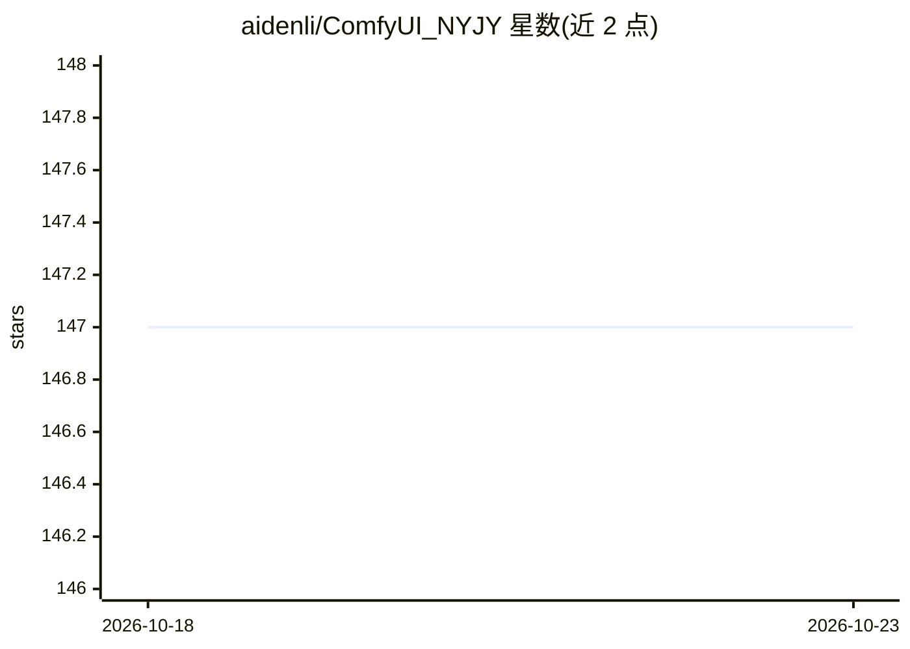

# aidenli/ComfyUI_NYJY

⭐ 147 · Python · Apache-2.0 · 推送 2026-04-30 · [GitHub](https://github.com/aidenli/ComfyUI_NYJY) · 个人维护 · 中文 README

**ComfyUI 自定义节点集：提示词翻译、图片反推、C站提示词获取**

面向 ComfyUI 用户的自定义节点集合，提供四类节点：Translate 翻译节点（对接谷歌翻译与百度翻译，支持多语言，需配置百度翻译参数）、JoyTag 节点（对图片反推输出 tags）、JoyCaption 节点（对图片反推输出自然语言描述）、CivitaiPrompt 节点（随机获取 Civitai 站点图片的提示词）。2025-03 更新接入阿里百炼平台的文本推理与图片理解能力。安装通过 ComfyUI Manager 的 Git URL 或手动下载 ZIP 解压到 custom_nodes 目录。

## 筛选速览

| 维度 | 判定 | 备注 |
|---|---|---|
| AI 角色 | `ai-ecosystem` | LLM/agent 周边工具 |
| 许可风险 | `permissive` | Apache-2.0 |
| 部署形态 | `None` |  |
| 模型依赖 | — | README 未给出锁定关系 |
| 硬件要求 | — | 无带数字的原话,不猜 |
| 安装摩擦 | `low` | 无编译、无系统依赖或容器化 |
| 成熟度 | — | 结构信号不足 |

## 能力要点

- Translate 节点对接谷歌翻译与百度翻译，支持多语言
- JoyTag / JoyCaption 反推图片输出 tags 或自然语言
- CivitaiPrompt 随机获取 Civitai 图片提示词
- 已接入阿里百炼平台（文本推理、图片理解）

## 适用场景

- 在 ComfyUI 工作流中将中文提示词翻译为英文
- 为无提示词的图片反推 tags 或自然语言描述
- 随机参考 Civitai 站点图片的提示词

## 场景标签

`提示工程` `图像视频处理` · 领域:Agent 开发

## 证据(README 行号)

> L9: #### Translate -- 翻译节点，对接谷歌翻译和百度翻译，支持多语言。（重要：百度翻译节点配置详细说明）
> L11: #### JoyTag -- 反推图片，输出tags。（点击查看详细）

## 星数曲线

2026-10-18 147 → 2026-10-23 147（+0）

---
*卡片 v1 · prompt 1.4 · 生成 2026-10-22 · 置信度 high · 依据 README sha `cd3eeb7bab81` · [字段定义](../../DATASET.md)*
