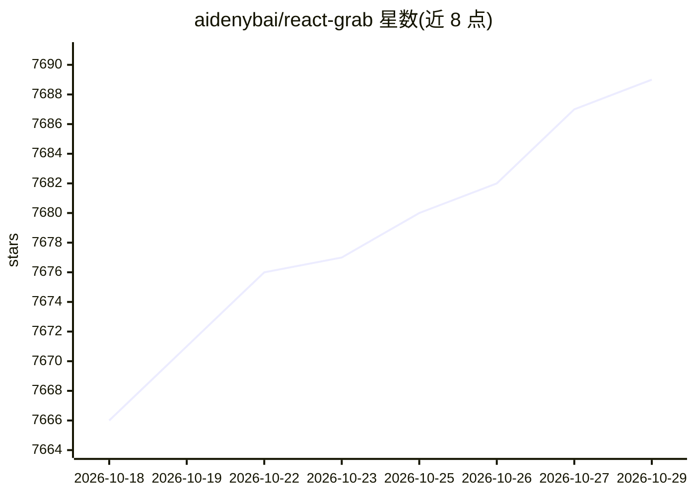

# aidenybai/react-grab

⭐ 7,689 · TypeScript · MIT · 推送 2026-08-22 · [GitHub](https://github.com/aidenybai/react-grab) · [官网](https://react-grab.com) · 个人维护

**把浏览器选中的 UI 元素复制为带源码位置的上下文供 agent 使用**

React 开发者工具库：在开发模式下悬停任意 UI 元素并按 ⌘C/Ctrl+C，复制出包含该元素及其组件栈、源码文件位置（如 login-form.tsx:46:19）的文本上下文，可粘贴给编码 agent 作为定位信息。通过 npx grab init 初始化，或按 Next.js/Vite/Webpack 等框架手动引入；另从 react-grab/primitives 暴露命中测试、源码上下文、剪贴板访问等 API 供自定义界面。MIT 许可。

## 筛选速览

| 维度 | 判定 | 备注 |
|---|---|---|
| AI 角色 | `ai-ecosystem` | LLM/agent 周边工具 |
| 许可风险 | `permissive` | MIT |
| 部署形态 | `library` | 以包/库形式分发 |
| 模型依赖 | — | README 未给出锁定关系 |
| 硬件要求 | — | 无带数字的原话,不猜 |
| 安装摩擦 | `low` | 无编译、无系统依赖或容器化 |
| 成熟度 | — | 结构信号不足 |

## 能力要点

- 选区→组件栈+源码位置的上下文复制（⌘C/Ctrl+C）
- 支持 Next.js（App/Pages router）、Vite、Webpack 手动接入
- react-grab/primitives 提供命中测试、页面冻结、编辑器跳转等 API
- npx grab@latest init 一键初始化

## 适用场景

- 把界面上出问题的元素直接复制给 AI 编码助手定位源码
- 在 agent 工作流中提供 UI 元素的组件栈上下文
- 基于 primitives API 构建自定义选取工具

## 场景标签

 · 领域:前端开发工具/AI 编码

## 证据(README 行号)

> L6: Copy any UI element for your agent.
> L22: React Grab turns a browser selection into source context your agent can use:

## 星数曲线

2026-10-18 7,666 → 2026-10-29 7,689（+23）

---
*卡片 v1 · prompt 1.4 · 生成 2026-10-20 · 置信度 high · 依据 README sha `b5719a99bf7d` · [字段定义](../../DATASET.md)*
