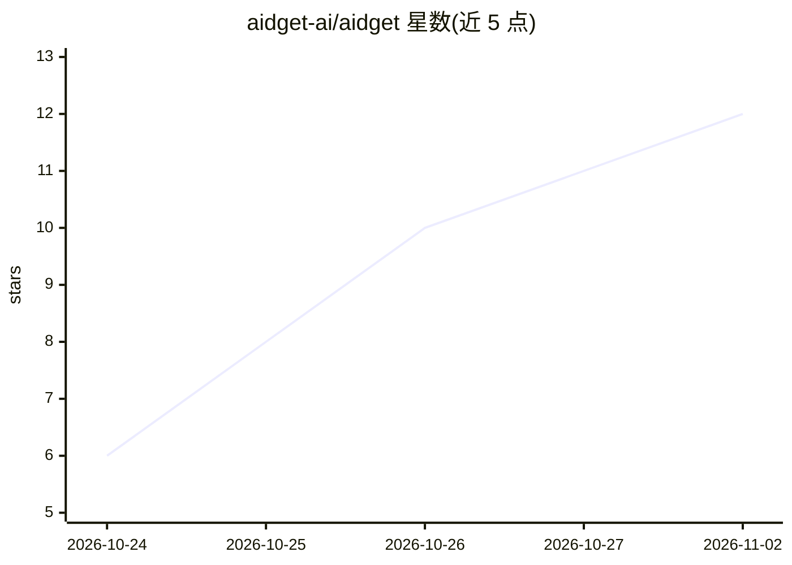

# aidget-ai/aidget

⭐ 12 · Rust · MIT · 推送 2026-10-31 · [GitHub](https://github.com/aidget-ai/aidget) · [官网](https://aidget-ai.github.io/widgets/) · 组织维护 · 中文 README

**让 AI Agent 在桌面上创建和管理小组件的跨平台应用**

基于 Tauri 2 + Rust 的桌面小组件管理工具，通过 MCP 服务与 Agent Skill 把桌面暴露给 ChatGPT、Claude、Grok 等桌面 Agent：用户在 Agent 对话中用自然语言描述需求，Agent 调用 aidget 的 9 个 MCP 工具（创建/更新/移动/截图/删除小组件等）生成 HTML/CSS 小组件并摆放至桌面。支持 macOS/Windows/Linux，提供 widget 级权限声明（script/storage/location）与网络来源白名单，默认零权限并运行于沙箱。社区小组件经安全审查后可安装。开发构建需 Rust 1.92+、Node.js 22/24 与 pnpm。

## 筛选速览

| 维度 | 判定 | 备注 |
|---|---|---|
| AI 角色 | `ai-ecosystem` | LLM/agent 周边工具 |
| 许可风险 | `permissive` | MIT |
| 部署形态 | `library` | 以包/库形式分发 |
| 模型依赖 | — | README 未给出锁定关系 |
| 硬件要求 | — | 无带数字的原话,不猜 |
| 安装摩擦 | `low` | 无编译、无系统依赖或容器化 |
| 成熟度 | — | 结构信号不足 |

## 能力要点

- 9 个 MCP 工具覆盖小组件创建、更新、补丁、移动、截图、删除全流程
- widget 级权限模型：script/storage/location 与 HTTPS 来源白名单，默认零权限沙箱
- macOS/Windows/Linux 三平台支持，自动检测常见本地 Agent 应用
- 社区小组件仓库（经安全审查）与 CLI（aidget ui/mcp/widget）

## 适用场景

- 让 ChatGPT/Claude 等桌面 Agent 帮我在桌面上做便签、天气、股票追踪小组件
- 通过自然语言安排定时任务型桌面小组件
- 给 Agent 提供一个受权限控制、沙箱化的桌面操作通道

## 场景标签

`GUI 自动化` · 领域:效率与自动化

## 证据(README 行号)

> L11: MCP
> L61: 1. Open the **MCP & Skills** page.
> L135: |Tool|Purpose|

## 星数曲线

2026-10-24 6 → 2026-11-02 12（+6）

---
*卡片 v1 · prompt 1.4 · 生成 2026-11-02 · 置信度 mid · 依据 README sha `29a5fd3e93f3` · [字段定义](../../DATASET.md)*
