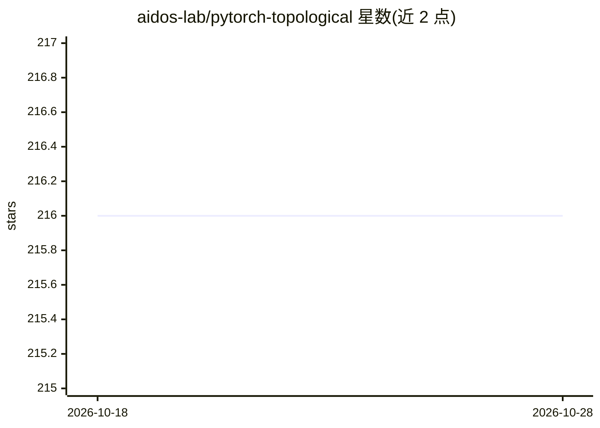

# aidos-lab/pytorch-topological

⭐ 216 · Python · BSD-3-Clause · 推送 2026-02-11 · [GitHub](https://github.com/aidos-lab/pytorch-topological) · [官网](https://pytorch-topological.readthedocs.io/) · 组织维护

**给ML研究者的PyTorch拓扑机器学习框架：损失项与网络层**

基于PyTorch的拓扑机器学习框架，以 Python 包（torch_topological）形式提供拓扑数据的损失项（loss terms）与神经网络层，用于构建结合拓扑特征的机器学习模型。要求 Python 3.9，可用 poetry 或 pip 安装。作者声明项目仍在开发中（work in progress），文档与示例代码可用；README 列出使用该库的项目（如 SHAPR 3D 细胞形状预测）及技术基础依赖 giotto-tda、GUDHI、POT 等，并附拓扑机器学习领域论文与项目资源。

## 筛选速览

| 维度 | 判定 | 备注 |
|---|---|---|
| AI 角色 | `ai-ecosystem` | LLM/agent 周边工具 |
| 许可风险 | `permissive` | BSD-3-Clause |
| 部署形态 | `library` | 以包/库形式分发 |
| 模型依赖 | — | README 未给出锁定关系 |
| 硬件要求 | — | 无带数字的原话,不猜 |
| 安装摩擦 | `low` | 无编译、无系统依赖或容器化 |
| 成熟度 | `idea` | |

## 能力要点

- 提供拓扑机器学习用的损失项与神经网络层
- 基于 PyTorch，pip/poetry 可安装
- 附示例代码、文档与领域文献列表
- 被 SHAPR（3D 细胞形状预测）等项目使用

## 适用场景

- 在 PyTorch 模型中加入基于拓扑特征（连接性）的损失项
- 开展拓扑机器学习研究并复用现成的层与损失组件
- 学习拓扑数据分析与机器学习结合的方法与文献

## 场景标签

 · 领域:机器学习/拓扑数据分析

## 证据(README 行号)

> L7: `pytorch-topological` (or `torch_topological`) is a topological machine
> L9: collect *loss terms* and *neural network layers* in order to simplify

## 星数曲线

2026-10-18 216 → 2026-10-28 216（+0）

---
*卡片 v1 · prompt 1.4 · 生成 2026-10-22 · 置信度 high · 依据 README sha `37f01185cf97` · [字段定义](../../DATASET.md)*
