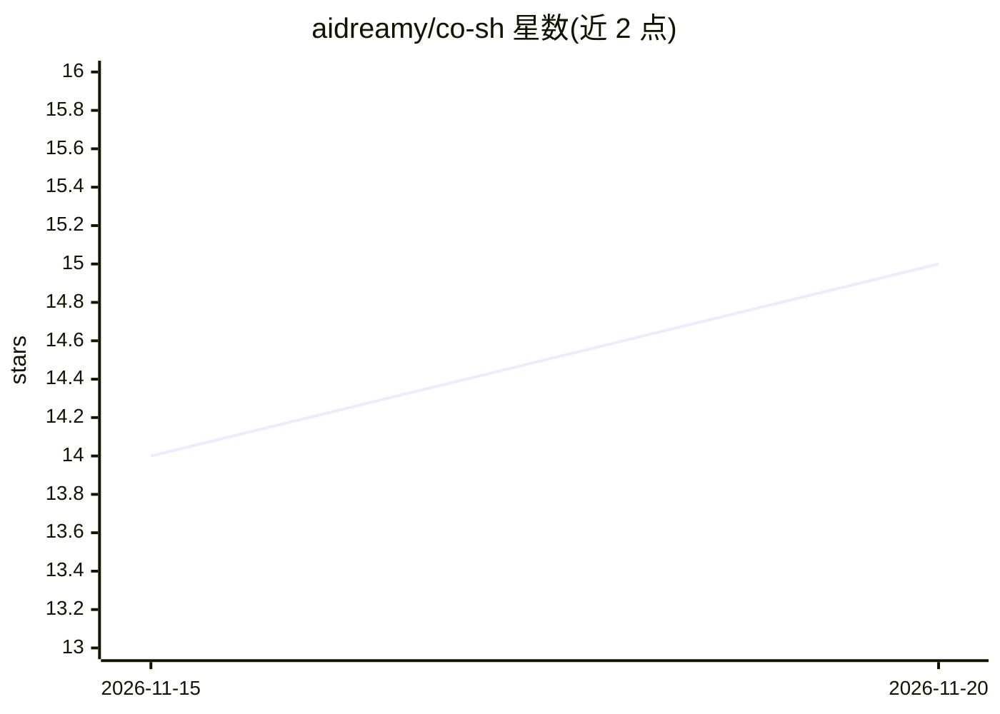

# aidreamy/co-sh

⭐ 15 · Rust · Apache-2.0 · 推送 2026-11-18 · [GitHub](https://github.com/aidreamy/co-sh) · [官网](https://www.co-sh.com) · 个人维护 · 中文 README

**终端多 agent 编排器：在 Rust TUI 中协调多个编程 agent**

用 Rust 编写的终端通用编程 agent 与多 agent 编排层：在同一 TUI 的分屏面板中并行运行外部 agent（Claude、Gemini、Codex、Cline 等），每个 agent 保持独立会话、模型与可选 git worktree，由主 agent 分发任务并收集报告；通过可访问性树读取与操作图形界面，仅在需要时回退到截图；支持在界面内配置 provider、模型与运行模式。模块化拆分为工具、TUI、SDK、记忆召回等独立 crate。提供 Linux/macOS/Windows 安装脚本，Linux 与 Windows 经过测试。

## 筛选速览

| 维度 | 判定 | 备注 |
|---|---|---|
| AI 角色 | `ai-ecosystem` | LLM/agent 周边工具 |
| 许可风险 | `permissive` | Apache-2.0 |
| 部署形态 | `None` |  |
| 模型依赖 | — | README 未给出锁定关系 |
| 硬件要求 | — | 无带数字的原话,不猜 |
| 安装摩擦 | `low` | 无编译、无系统依赖或容器化 |
| 成熟度 | — | 结构信号不足 |

## 能力要点

- 同一 TUI 分屏并行运行多个外部 agent，主 agent 协调任务分发与报告收集
- 通过 accessibility tree 操作图形界面，仅在需要时回退截图以减少 token 消耗
- Rust/Ratatui 构建的 TUI，界面内配置 provider 与模型
- 模块化 crate：cosh-tools、cosh-tui、cosh-sdk、cosh-recall、cosh-onnx

## 适用场景

- 在多任务并行时用 manager 模式协调多个编程 agent
- 在统一界面里试验与组合不同 agent 的能力
- 让 agent 通过结构化界面表示操作图形应用

## 场景标签

`多智能体` `编码 Agent` · 领域:Agent 开发

## 证据(README 行号)

> L8: Cosh is a general-purpose coding agent for the terminal, with software engineering tools and *computer tools* that l
> L12: co-sh isn't meant to replace established coding agents — it's designed to work alongside them as an orchestration l
> L14: - **Multi-agent collaboration** — Run different state-of-the-art agents (Claude, Gemini, Codex, Cline, etc.) direct

## 星数曲线

2026-11-15 14 → 2026-11-20 15（+1）

---
*卡片 v1 · prompt 1.4 · 生成 2026-11-18 · 置信度 high · 依据 README sha `64e1690d579e` · [字段定义](../../DATASET.md)*
