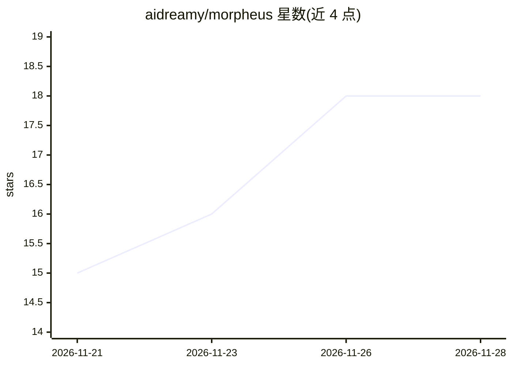

# aidreamy/morpheus

⭐ 18 · Rust · GPL-3.0 · 推送 2026-11-27 · [GitHub](https://github.com/aidreamy/morpheus) · [官网](https://morpheus.aidreamy.com) · 个人维护

**面向终端的 Rust 多智能体编排器：统一管理多个 coding agent**

用 Rust（Ratatui）编写的通用终端 coding agent，定位为在既有 agent 之上增加编排层：在单一 TUI 中以分屏运行多个外部 agent（每个保留独立会话、模型与可选 git worktree），主 agent 协调分发任务并汇总报告。另提供经 accessibility tree 读取和操作图形界面的 computer tools、应用内配置 provider/模型，以及 tools/TUI/SDK/recall 等独立可复用 crate。通过脚本安装，支持 Linux/Windows，macOS 未测试。

## 筛选速览

| 维度 | 判定 | 备注 |
|---|---|---|
| AI 角色 | `ai-ecosystem` | LLM/agent 周边工具 |
| 许可风险 | `viral` | GPL-3.0 |
| 部署形态 | `None` |  |
| 模型依赖 | — | README 未给出锁定关系 |
| 硬件要求 | — | 无带数字的原话,不猜 |
| 安装摩擦 | `low` | 无编译、无系统依赖或容器化 |
| 成熟度 | — | 结构信号不足 |

## 能力要点

- 多 agent 分屏并行运行，主 agent 统一调度与收集报告
- 经 accessibility tree 驱动 GUI，减少截图与 token 消耗
- Provider、模型与模式在 TUI 内直接配置
- 模块化 crate：工具、TUI 组件、SDK、记忆召回可独立复用

## 适用场景

- 在多个 coding agent 之间切换与组合，共处同一终端工作区
- 并行处理多个小任务时在现有 agent 之上叠加编排
- 让 agent 读取和操作图形界面应用

## 场景标签

`多智能体` `编码 Agent` `GUI 自动化` · 领域:Agent 开发

## 证据(README 行号)

> L11: Morpheus is not meant to replace established coding agents. It is designed to work alongside them as an orchestrati
> L13: - **Multi-agent collaboration**: run different state-of-the-art agents (Claude, Gemini, Codex, Cline, etc.) in the 

## 星数曲线

2026-11-21 15 → 2026-11-28 18（+3）

---
*卡片 v1 · prompt 1.4 · 生成 2026-11-21 · 置信度 high · 依据 README sha `9451be2530d7` · [字段定义](../../DATASET.md)*
