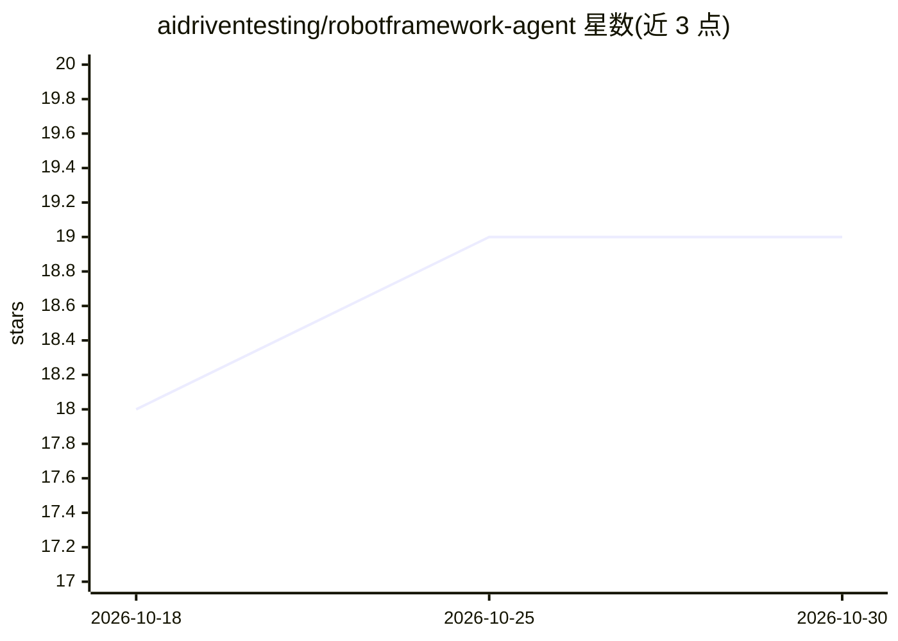

# aidriventesting/robotframework-agent

⭐ 19 · Python · MIT · 推送 2026-01-19 · [GitHub](https://github.com/aidriventesting/robotframework-agent) · 组织维护

**给测试工程师：用自然语言驱动 Web/移动 UI 自动化的 Robot Framework 库**

Robot Framework 的 Agent 扩展库：测试步骤用自然语言编写，由 LLM 结合 UI 结构与视觉理解转换为基于工具的界面操作与检查，支持 OpenAI（默认）、Anthropic Claude、Google Gemini 三家模型，覆盖 Web 与移动平台。提供 Agent.Do/Check/Ask/Find Visual Element 四类关键字，采用 OmniParser 视觉解析与 Set-of-Mark 技术做元素定位。自述处于 Alpha 阶段，各关键字成熟度不一，不建议用于生产环境。

## 筛选速览

| 维度 | 判定 | 备注 |
|---|---|---|
| AI 角色 | `ai-ecosystem` | LLM/agent 周边工具 |
| 许可风险 | `permissive` | MIT |
| 部署形态 | `library` | 以包/库形式分发 |
| 模型依赖 | locked-api |  |
| 硬件要求 | — | 无带数字的原话,不猜 |
| 安装摩擦 | `low` | 无编译、无系统依赖或容器化 |
| 成熟度 | `idea` | |

## 能力要点

- 自然语言指令经 LLM 转换为工具化 UI 操作与校验
- 支持 OpenAI、Anthropic Claude、Google Gemini 三家 LLM 提供商
- OmniParser 视觉解析与 Set-of-Mark 视觉定位技术
- 覆盖 Web 与移动平台，含视觉/语义校验关键字

## 适用场景

- 用自然语言编写 Web/移动端 UI 自动化测试步骤
- 对界面做视觉或语义层面的自动化验证与状态查询
- 按描述定位页面元素辅助测试脚本编写

## 场景标签

`GUI 自动化` `浏览器自动化` · 领域:效率与自动化

## 证据(README 行号)

> L3: Enable Agent-mode automation. Write natural-language steps; and let the Agent turns them into tool-based UI actions 
> L30: Supports OpenAI (default), Anthropic Claude, and Google Gemini.

## 星数曲线

2026-10-18 18 → 2026-10-30 19（+1）

---
*卡片 v1 · prompt 1.4 · 生成 2026-10-28 · 置信度 high · 依据 README sha `8e09afb27504` · [字段定义](../../DATASET.md)*
