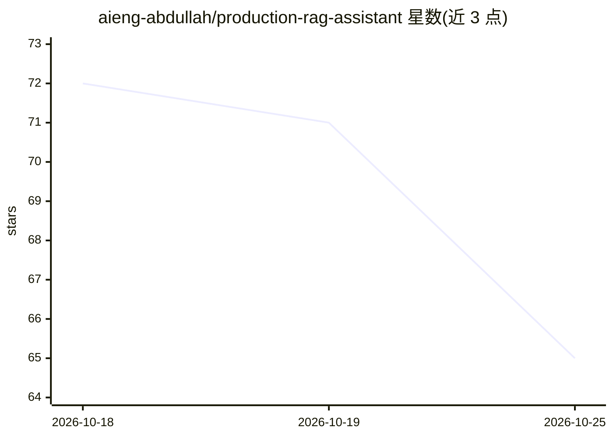

# aieng-abdullah/production-rag-assistant

⭐ 65 · Python · MIT · 推送 2026-10-24 · [GitHub](https://github.com/aieng-abdullah/production-rag-assistant) · [官网](https://groundedai-frontend.onrender.com) · 个人维护

**面向法律/学术的引用强制核验 RAG 研究助手**

GroundedAI 是一个引用核验型 RAG 问答应用：上传 PDF 后提问，系统用 BM25+向量混合检索、RRF 融合、cross-encoder 重排取回相关段落，LLM 仅基于检索内容作答；每条事实性句子必须携带页级 [SOURCE N] 引用与逐字引文，由 Pydantic 在代码层校验引文确实出现在所引 chunk 中，未引用或误引的回答在返回前被拒绝；来源不足时回答"信息不足"而非猜测。提供法律与学术两个工作区，医疗与孟加拉语为二期规划；技术栈为 FastAPI + React + Qdrant + LangChain，LLM 走 Groq→Anthropic→OpenAI 故障转移，支持自托管（本地或 Docker Compose），多租户隔离，内置 Ragas 评估与 Langfuse 追踪。

## 筛选速览

| 维度 | 判定 | 备注 |
|---|---|---|
| AI 角色 | `ai-native` | 本体是模型或模型工具 |
| 许可风险 | `none` | MIT |
| 部署形态 | `self-host` | docker 或自建部署 |
| 模型依赖 | locked-api |  |
| 硬件要求 | — | 无带数字的原话,不猜 |
| 安装摩擦 | `low` | 无编译、无系统依赖或容器化 |
| 成熟度 | — | 结构信号不足 |

## 能力要点

- 代码级引用校验门：Pydantic 强制每条 claim 携带逐字引文并核验包含关系
- 混合检索 BM25 ∥ 向量 → RRF → cross-encoder 重排
- 来源不足时优雅弃答而非猜测
- Groq → Anthropic → OpenAI 提供商故障转移与重试

## 适用场景

- 对法规、合同、论文提问并获得可点击溯源到页码的回答
- 律师团队做条文/合同问答（报告而非建议，严格弃答）
- 研究者跨论文综合时避免编造引用
- 工程师自托管（Docker Compose）保护私有文档数据

## 场景标签

`RAG` `文档问答` `科研工具` · 领域:知识与检索

## 证据(README 行号)

> L41: Upload a PDF → ask a question → get an answer where **every factual sentence carries a page-level `[SOURCE N]` cita
> L48: |**4. Validate**|Pydantic requires **every claim** to carry a citation, and checks each quote appears verbatim in t

## 星数曲线

2026-10-18 72 → 2026-10-25 65（-7）

---
*卡片 v1 · prompt 1.4 · 生成 2026-10-24 · 置信度 high · 依据 README sha `3dcc9532fc31` · [字段定义](../../DATASET.md)*
