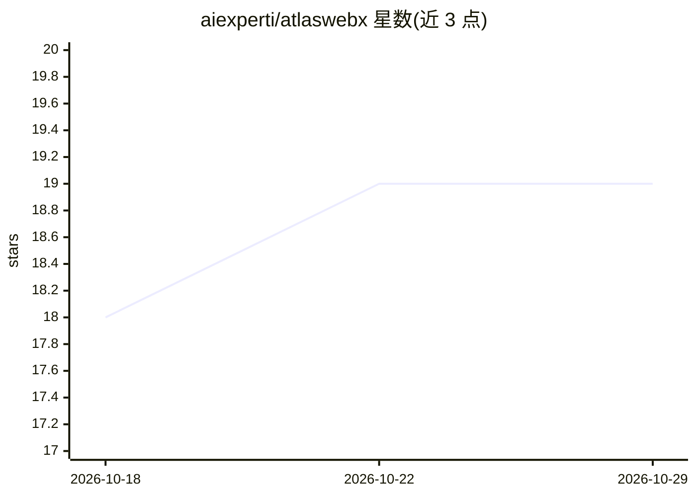

# aiexperti/atlaswebx

⭐ 19 · JavaScript · MIT · 推送 2025-11-12 · [GitHub](https://github.com/aiexperti/atlaswebx) · [官网](https://atlaswebx.com) · 个人维护

**带 AI 侧边栏助手的开源 Electron 网页浏览器**

基于 Electron 构建的桌面网页浏览器：多标签浏览、地址栏自动补全、内置广告拦截（@cliqz/adblocker-electron）、可折叠侧栏、暗色主题与可拖拽的应用快捷方式网格。AI 部分为侧边栏助手：接入 OpenAI GPT-4o-mini，支持页面元素选择、页面内容问答与页面修改（改色/隐藏元素）、网页搜索总结；API key 通过设置界面存于本地。安装需 Node.js v16+，从源码 clone 后 npm install 运行，本地 LLM 支持仍在路线图未实现。

## 筛选速览

| 维度 | 判定 | 备注 |
|---|---|---|
| AI 角色 | `ai-enhanced` | 去掉 AI 部分产品仍成立 |
| 许可风险 | `permissive` | MIT |
| 部署形态 | `library` | 以包/库形式分发 |
| 模型依赖 | — | README 未给出锁定关系 |
| 硬件要求 | — | 无带数字的原话,不猜 |
| 安装摩擦 | `low` | 无编译、无系统依赖或容器化 |
| 成熟度 | — | 结构信号不足 |

## 能力要点

- 接入 OpenAI GPT-4o-mini 的侧边栏 AI 助手
- AI 页面元素选择与页面修改（改色/隐藏元素）
- 内置 Cliqz 广告拦截与多标签管理
- API key 经设置界面存于本地存储

## 适用场景

- 日常网页浏览并随时向 AI 询问页面内容
- 通过对话让 AI 修改页面样式或隐藏元素
- 让 AI 代为执行网页搜索并总结结果

## 场景标签

`AI 助手` · 领域:对话与助手

## 证据(README 行号)

> L3: **A Modern AI-Powered Browser Built with Electron**
> L29: ### 🤖 AI Assistant Sidebar
> L200: - [ ] **Enhanced AI Features**

## 星数曲线

2026-10-18 18 → 2026-10-29 19（+1）

---
*卡片 v1 · prompt 1.4 · 生成 2026-10-28 · 置信度 high · 依据 README sha `1fff355d8fa8` · [字段定义](../../DATASET.md)*
