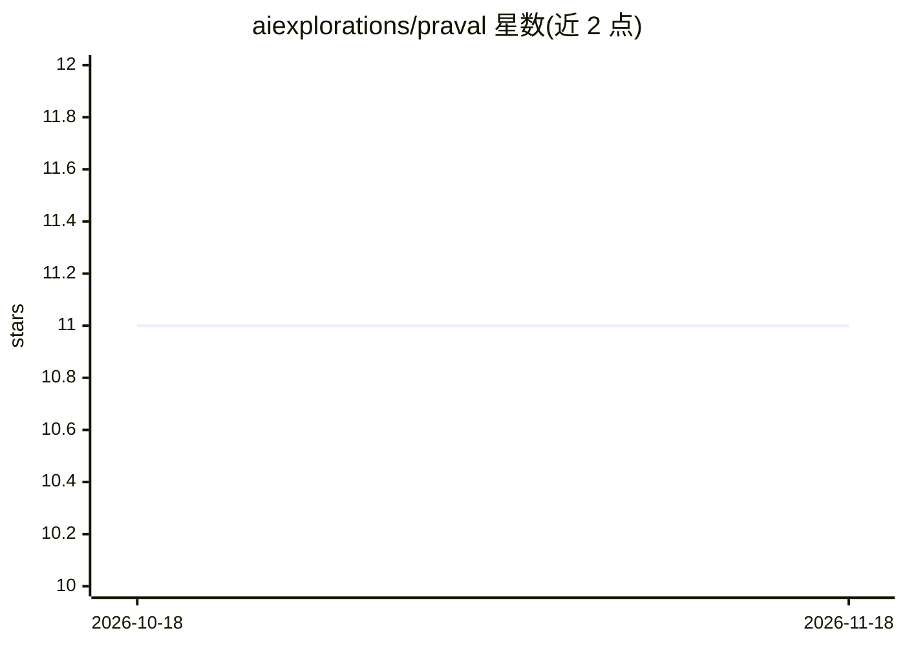

# aiexplorations/praval

⭐ 11 · Python · MIT · 推送 2026-11-03 · [GitHub](https://github.com/aiexplorations/praval) · [官网](https://pravalagents.com) · 组织维护

**Python 多智能体框架：构建模型驱动的 agent 与消息协作团队**

面向构建 agent 系统的 Python 框架。单个 Agent 支持 provider 中立的模型运行时、工具、流式输出、结构化输出、记忆、多模态输入与请求式语音（STT/TTS）；多个 agent 通过内置的 Reef 消息层以 Spore 结构化消息协作，支持直接投递、广播、频道、请求回复与 RabbitMQ 分布式后端。另提供 HITL 工具审批、MCP 客户端、存储/嵌入、可观测性与评测等可选能力，以 pip 安装，支持 Python 3.10–3.14。

## 筛选速览

| 维度 | 判定 | 备注 |
|---|---|---|
| AI 角色 | `ai-ecosystem` | LLM/agent 周边工具 |
| 许可风险 | `permissive` | MIT |
| 部署形态 | `library` | 以包/库形式分发 |
| 模型依赖 | local-ok | 支持本地模型 |
| 硬件要求 | — | 无带数字的原话,不猜 |
| 安装摩擦 | `low` | 无编译、无系统依赖或容器化 |
| 成熟度 | — | 结构信号不足 |

## 能力要点

- provider 中立的 ModelRuntime：统一响应元数据、同步/异步与流式 API
- Reef agent 间消息投递层，支持 RabbitMQ 分布式后端
- HITL 审批（approve/edit/reject/persist/resume）与 MCP 客户端
- 13 门课程 notebook、4 个 capstone 与可运行示例

## 适用场景

- 构建多专家 agent 协作的任务流水线
- 以统一 API 接入 OpenAI/Anthropic/Cohere/Gemini 等模型
- 为敏感工具调用加入人工审批流程
- 离线学习 agent 系统课程与完整生产式案例

## 场景标签

`多智能体` `Agent 框架` · 领域:Agent 开发

## 证据(README 行号)

> L11: Praval is a focused Python framework for agent systems. One agent can use a
> L191: |Model execution|Provider-neutral requests, responses, events, capabilities, usage, and errors|ModelRuntime|
> L192: |Provider adapters|OpenAI, Anthropic, Cohere, Gemini, OpenRouter, and OpenAI-compatible servers|Providers|

## 星数曲线

2026-10-18 11 → 2026-11-18 11（+0）

---
*卡片 v1 · prompt 1.4 · 生成 2026-11-18 · 置信度 high · 依据 README sha `25a4ca0a06bf` · [字段定义](../../DATASET.md)*
