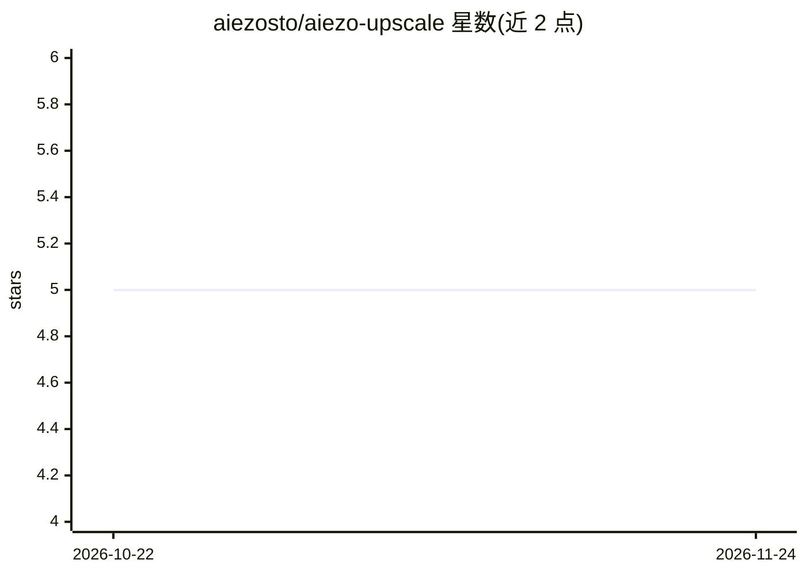

# aiezosto/aiezo-upscale

⭐ — · [GitHub]() · 组织维护

**Windows 桌面端本地 AI 图片放大工具，输出 2K/4K/8K**

免费开源的 Windows 桌面应用：输入模糊/破损图片，通过本地运行的 SeedVR2（单步 diffusion，7B 与 3B 两种规格）及经典模型（Real-ESRGAN/Real-ESRNet、SwinIR、HAT）输出最高 8K 的放大图。AI 在本地 NVIDIA GPU 上运行，无需联网、不上传图片。另提供真实分辨率测量、back-projection、去偏色、Richardson–Lucy 反卷积锐化、PSNR/SSIM 对比度量和批量处理；可选配置付费 API（fal.ai、Google Imagen Upscale）。

## 筛选速览

| 维度 | 判定 | 备注 |
|---|---|---|
| AI 角色 | `ai-native` | 本体是模型或模型工具 |
| 许可风险 | `permissive` | — |
| 部署形态 | `desktop` | 安装包/桌面程序 |
| 模型依赖 | — | README 未给出锁定关系 |
| 硬件要求 | `gpu-8g` | |
| 安装摩擦 | `medium` | 含编译或系统依赖之一 |
| 成熟度 | — | 结构信号不足 |

## 能力要点

- SeedVR2（7B/3B）本地 GPU 推理，无网络、图片不上传
- 多模型管线：Real-ESRGAN/Real-ESRNet、SwinIR、HAT-L
- PSNR/SSIM 量化报告与前后滑动对比、批量目录处理
- 支持透明背景、16-bit 图像与 ICC 色彩配置文件保留

## 适用场景

- 把模糊旧照片放大到 4K/8K 用于打印或展示
- 本地离线批量放大整个文件夹的图片
- 需要保留透明背景与色彩配置的素材处理

## 场景标签

`图像视频处理` · 领域:感知与多模态

## 证据(README 行号)

> L3: Ứng dụng desktop Windows **miễn phí, mã nguồn mở**: đưa ảnh vỡ / nhoè vào, xuất ảnh 2K, 4K, 8K đã làm nét.
> L18: - **SeedVR2** (ByteDance Seed, diffusion một bước) chạy trên máy: tăng chi tiết mà giữ nguyên người, vật, bố cục.
> L46: main.py               cửa sổ desktop (pywebview + WebView2), --selftest

## 星数曲线

2026-10-22 5 → 2026-11-24 5（+0）

---
*卡片 v1 · prompt 1.4 · 生成 2026-11-21 · 置信度 high · 依据 README sha `0c5ab558b0d6` · [字段定义](../../DATASET.md)*
