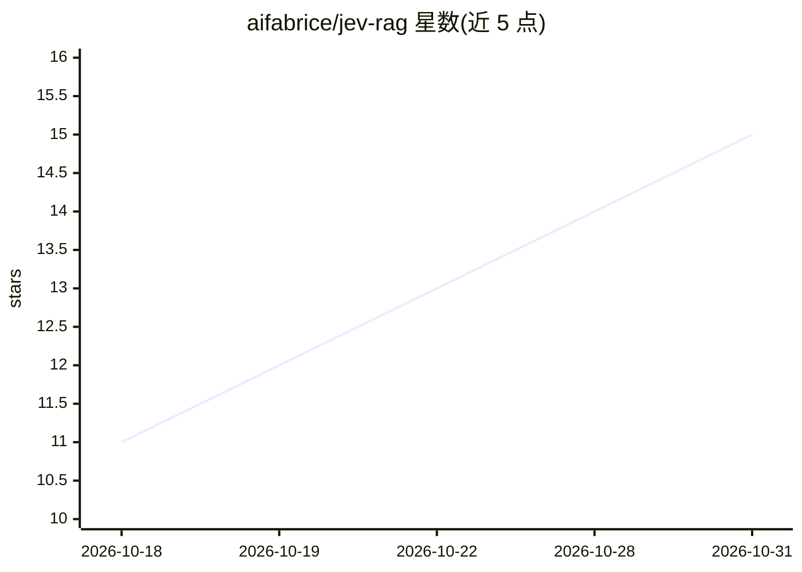

# aifabrice/jev-rag

⭐ 15 · Python · MIT · 推送 2026-10-25 · [GitHub](https://github.com/aifabrice/jev-rag) · [官网](https://aifabrice.github.io/jev-rag/) · 个人维护 · 中文 README

**本地优先的向量无关 RAG 知识搜索引擎，带引用回答**

面向开发者的本地知识检索引擎：索引本地文件夹（默认 ~/Documents），默认路径用 SQLite FTS5/BM25 检索后经 Jev 重排，再由远端模型生成带编号文件引用的流式回答；无需向量数据库与 GPU。UI/CLI 提供七种管线（Agentic、Hybrid、Taxonomy、Passage Gate、Line Search 等），支持中英检索与 CJK bigram 分词，可增量索引 Markdown/PDF/DOCX 等 8 种格式。默认端到端路径需 OpenRouter API key；Passage Gate 为公开的负结果实验。自述状态为 alpha，1.0 前 API 与存储结构可能变动。

## 筛选速览

| 维度 | 判定 | 备注 |
|---|---|---|
| AI 角色 | `ai-native` | 本体是模型或模型工具 |
| 许可风险 | `permissive` | MIT |
| 部署形态 | `library` | 以包/库形式分发 |
| 模型依赖 | locked-api |  |
| 硬件要求 | — | 无带数字的原话,不猜 |
| 安装摩擦 | `low` | 无编译、无系统依赖或容器化 |
| 成熟度 | `idea` | |

## 能力要点

- 七种可选检索管线，默认 BM25 + Jev，无需向量数据库
- 流式生成带编号文件引用的回答，记录每阶段延迟与成本
- 支持 Markdown/text/HTML/JSON/CSV/YAML/DOCX/PDF 增量索引
- 公开 BEIR NFCorpus 323 查询基准，含负结果与成本披露

## 适用场景

- 对本地文档文件夹做带引用的问答检索
- 在无 GPU、无向量数据库的环境下搭建个人知识库
- 对比多种检索管线在自有文档上的效果与延迟

## 场景标签

`RAG` `文档问答` · 领域:知识与检索

## 证据(README 行号)

> L3: **Jev RAG is an open-source local knowledge search engine with seven selectable pipelines: BM25 + Jev by default, ag
> L5: Use Jev RAG to search a local document folder, rerank candidate passages with
> L6: Jev, and stream grounded answers with file citations. The default path is a

## 星数曲线

2026-10-18 11 → 2026-10-31 15（+4）

---
*卡片 v1 · prompt 1.4 · 生成 2026-10-31 · 置信度 high · 依据 README sha `42f5289b68d8` · [字段定义](../../DATASET.md)*
