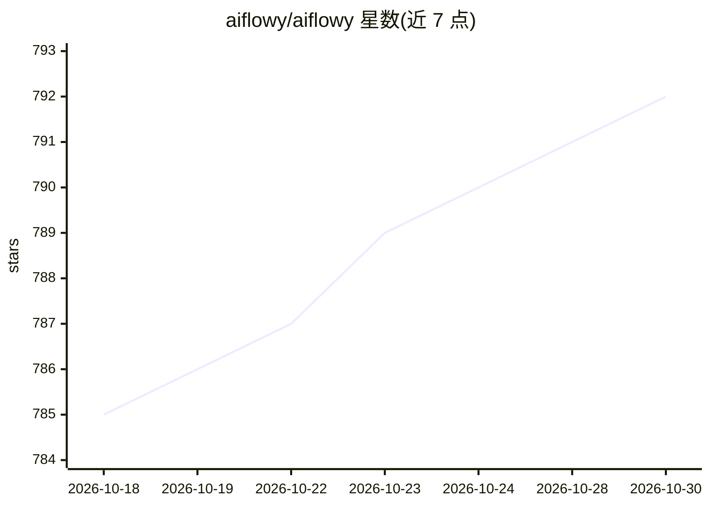

# aiflowy/aiflowy

⭐ 792 · Vue · NOASSERTION · 推送 2026-06-15 · [GitHub](https://github.com/aiflowy/aiflowy) · [官网](https://aiflowy.tech) · 组织维护 · 中文 README

**Java 企业级 AI 应用开发平台：Bot/RAG/工作流一体化**

基于 Java（Spring Boot 3 + Agents-Flex）构建的开源企业级 AI 应用开发平台，支持 Bot 构建部署、插件系统、RAG 知识库、可视化 AI 工作流编排、多媒体中心、多模型管理与 MCP 集成；内置用户/角色/部门/权限体系、API Key、定时任务等企业系统管理功能。面向需要在本地或私有环境部署 AI 应用的开发者与组织，支持中英文界面。采用 Apache 2.0 许可并附加品牌保留条款。

## 筛选速览

| 维度 | 判定 | 备注 |
|---|---|---|
| AI 角色 | `ai-ecosystem` | LLM/agent 周边工具 |
| 许可风险 | `none` | NOASSERTION |
| 部署形态 | `None` |  |
| 模型依赖 | — | README 未给出锁定关系 |
| 硬件要求 | — | 无带数字的原话,不猜 |
| 安装摩擦 | `medium` | 含编译或系统依赖之一 |
| 成熟度 | — | 结构信号不足 |

## 能力要点

- Bot 构建、RAG 知识库、可视化工作流（条件/分支/循环）全生命周期支持
- 多模型统一接入与 MCP 集成、自动调用
- 用户/角色/部门/权限体系与 API Key 等企业管理功能
- Apache 2.0 许可（附加品牌保留条款），允许商业使用

## 适用场景

- 企业内私有化部署 AI 智能体与知识库问答
- 通过可视化编排构建带分支循环的 AI 工作流
- 统一管理多个大模型接入与 API 分发

## 场景标签

`Agent 框架` `RAG` `工作流自动化` · 领域:Agent 开发

## 证据(README 行号)

> L7: AIFlowy is an **enterprise-grade, open-source AI application (agent) development platform** built with Java, designe
> L9: While AIFlowy competes with mainstream platforms such as Coze, and Dify, it distinguishes itself through a **strong 

## 星数曲线

2026-10-18 785 → 2026-10-30 792（+7）

---
*卡片 v1 · prompt 1.4 · 生成 2026-10-21 · 置信度 high · 依据 README sha `d630f876f8a7` · [字段定义](../../DATASET.md)*
