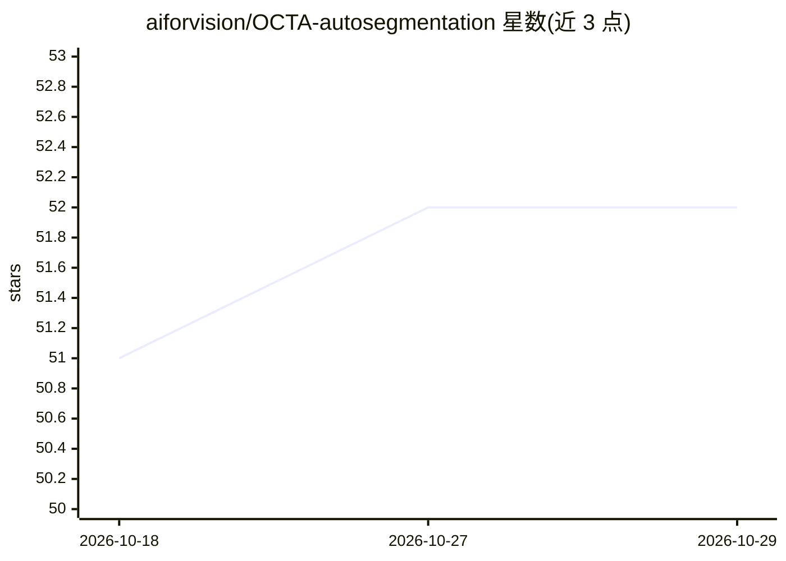

# aiforvision/OCTA-autosegmentation

⭐ 52 · Jupyter Notebook · MIT · 推送 2026-09-01 · [GitHub](https://github.com/aiforvision/OCTA-autosegmentation) · [官网](https://doi.org/10.1109/TMI.2024.3354408) · 组织维护

**无需人工标注的视网膜 OCTA 血管分割：合成数据训练模型**

2024 年 IEEE TMI 论文的官方代码库：基于空间殖民算法模拟视网膜血管网络生成合成 OCTA 图像，配合三种对比度适配管线缩小域差距，用迁移学习训练分割网络并在真实数据上推理，无需人工标注。提供预训练 GAN 与分割模型（OCTA-500 数据集）、500 个带标签合成样本，支持 Docker 一键分割/生成图像，也支持本地 uv/Python 3.13 环境训练、验证与推理；附两个示例 notebook 与 ROI 裁剪工具。评估基于 OCTA-500、ROSE-1、Giarratano 三个公开数据集。

## 筛选速览

| 维度 | 判定 | 备注 |
|---|---|---|
| AI 角色 | `ai-native` | 本体是模型或模型工具 |
| 许可风险 | `permissive` | MIT |
| 部署形态 | `self-host` | docker 或自建部署 |
| 模型依赖 | — | README 未给出锁定关系 |
| 硬件要求 | — | 无带数字的原话,不猜 |
| 安装摩擦 | `low` | 无编译、无系统依赖或容器化 |
| 成熟度 | — | 结构信号不足 |

## 能力要点

- 空间殖民算法合成视网膜血管网络 OCTA 图像
- 三条对比度适配管线缩小合成-真实域差距
- 提供预训练 GAN 与分割模型及 500 个合成训练样本
- Docker 与本地 uv 两种运行方式，含训练/验证/推理全流程

## 适用场景

- 对 3×3 mm² 黄斑 OCTA 图像做血管分割
- 生成带标签的合成 OCTA 训练数据
- 在自己的数据集上重新训练 GAN 与分割模型

## 场景标签

`目标检测` `模型训练` · 领域:感知与多模态

## 证据(README 行号)

> L2: This is the repository for the paper Synthetic optical coherence tomography angiographs for detailed retinal vessel 
> L8: Optical coherence tomography angiography(OCTA) is a non-invasive imaging modality that can acquire high-resolution v

## 星数曲线

2026-10-18 51 → 2026-10-29 52（+1）

---
*卡片 v1 · prompt 1.4 · 生成 2026-10-24 · 置信度 high · 依据 README sha `62444be4a8b4` · [字段定义](../../DATASET.md)*
