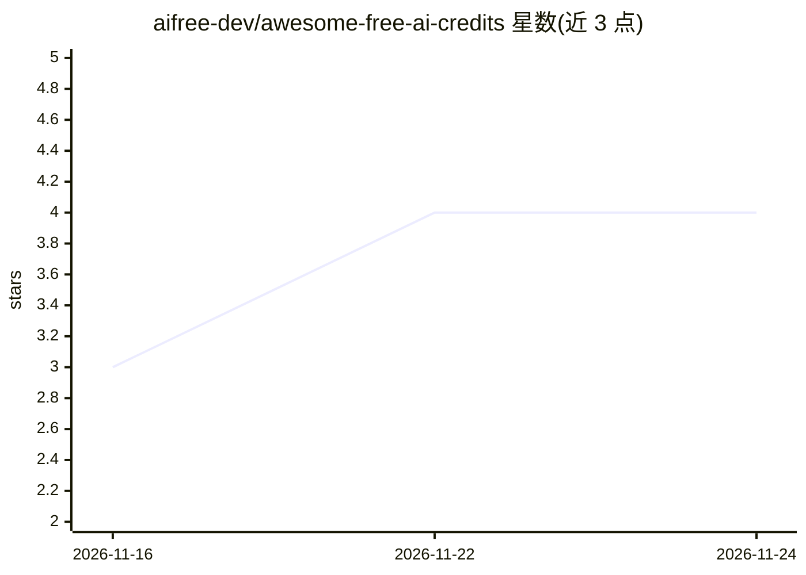

# aifree-dev/awesome-free-ai-credits

⭐ — · [GitHub]() · 组织维护

**面向开发者与学生/创业者的免费 AI 额度核验清单**

一份收录 195 条 AI 免费额度与免费套餐的聚合清单（163 条无需信用卡），覆盖 LLM API、编程助手、图像、语音、视频工具及 GPU 云资源；除永久免费层外还收录一次性赠金、学生认证优惠、创业额度包与试用期。每条由 aifree.dev 人工核验并附详情页链接、是否需绑卡与截止日期，过期条目会被移除；数据每周自动同步。清单本身不提供 API 或工具，仅组织外部优惠信息。

## 筛选速览

| 维度 | 判定 | 备注 |
|---|---|---|
| AI 角色 | `ai-knowledge` | 知识聚合/清单类 |
| 许可风险 | `none` | — |
| 部署形态 | `None` |  |
| 模型依赖 | — | README 未给出锁定关系 |
| 硬件要求 | — | 无带数字的原话,不猜 |
| 安装摩擦 | `low` | 无编译、无系统依赖或容器化 |
| 成熟度 | — | 结构信号不足 |

## 能力要点

- 195 条人工核验的免费额度条目，每周自动同步并移除过期项
- 每条标注是否需信用卡与有效期
- 覆盖 LLM API、编程、图像、语音、视频与 GPU 云六大类
- 提供学生优惠与创业额度两个专项入口

## 适用场景

- 学生找有学生认证优惠的 AI 服务
- 开发者按速率上限比较免费 LLM API
- 创业团队申领云与模型服务的启动赠金

## 场景标签

`精选清单` · 领域:学习与行业

## 证据(README 行号)

> L9: Every entry was verified by a person on aifree.dev and links to a detail page
> L13: **195 offers** (163 with no card) · last synced 2026-10-30 · data from aifree.dev, auto-updated weekly
> L26: One-off credit grants: sign up (sometimes verify), get a balance.

## 星数曲线

2026-11-16 3 → 2026-11-24 4（+1）

---
*卡片 v1 · prompt 1.4 · 生成 2026-11-22 · 置信度 high · 依据 README sha `f8b7db33dc00` · [字段定义](../../DATASET.md)*
