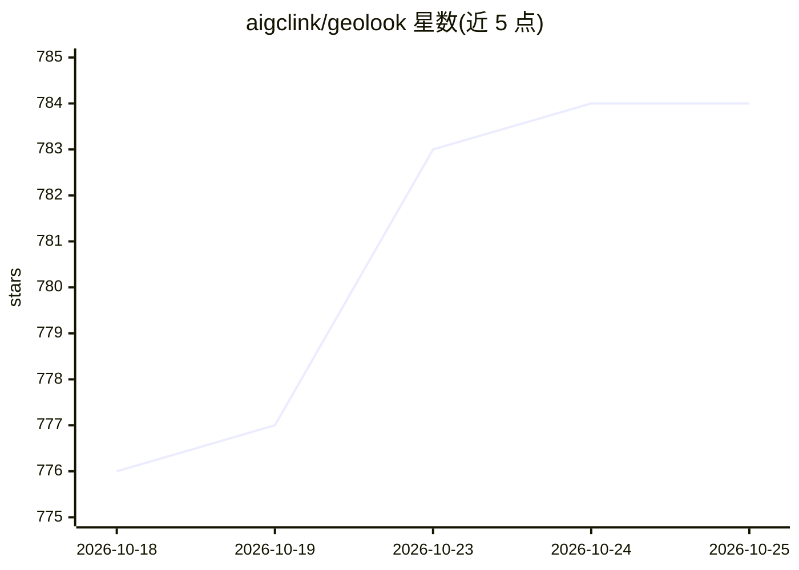

# aigclink/geolook

⭐ 784 · Python · MIT · 推送 2026-08-10 · [GitHub](https://github.com/aigclink/geolook) · [官网](https://geolook.cc) · 组织维护 · 中文 README

**自托管 GEO 平台：让 AI 引擎更多提及并引用你的品牌**

面向品牌方与 GEO 服务机构的自托管实施平台，覆盖状态分析→诊断→策略→工单→执行→验证全流程。机制包括：17 个引擎（含国产 GLM/豆包/DeepSeek/Kimi 等）采样并量化提及率/排名/引用份额，四层依赖链站点审计（RFC 9309 robots 解析、WAF/CDN 差异探测、段落级可引用性），结构化工单与 llms.txt/JSON-LD 资产生成，无 API 引擎用 Chrome 扩展人工采样。限制：单机工具、无协作账号、采样量取决于自有 API 预算。macOS/Linux 运行，仅需 3 个第三方包，零 key 也可工作。

## 筛选速览

| 维度 | 判定 | 备注 |
|---|---|---|
| AI 角色 | `ai-ecosystem` | LLM/agent 周边工具 |
| 许可风险 | `permissive` | MIT |
| 部署形态 | `None` |  |
| 模型依赖 | — | README 未给出锁定关系 |
| 硬件要求 | — | 无带数字的原话,不猜 |
| 安装摩擦 | `low` | 无编译、无系统依赖或容器化 |
| 成熟度 | — | 结构信号不足 |

## 能力要点

- 17 引擎采样量化提及率/排名/引用份额，含国产引擎矩阵
- 四层依赖链站点审计（Access→Orientation→Understanding→Quotability）
- 生成结构化工单与 llms.txt/JSON-LD 部署资产，自动验证与回归重开
- Chrome 采样扩展覆盖无 API 引擎，数据全部本地存储

## 适用场景

- 监测并提升品牌在 ChatGPT/DeepSeek 等 AI 回答中的提及与引用
- 为客户提供 GEO 诊断报告、执行计划与交付包
- 审计站点对 AI 爬虫的可访问性与内容可引用性

## 场景标签

`网页抓取` · 领域:效率与自动化

## 证据(README 行号)

> L19: > GEO = Generative Engine Optimization: getting AI engines (ChatGPT, Perplexity, Gemini, DeepSeek, Doubao…) to **pr
> L37: **Status** — Engine performance across 17 engines (10 automated via API + 7 manual, incl. Google AI Overviews and M
> L70: |**Chinese market**|Mostly Western engines|First-class CN engine matrix (GLM / Doubao / DeepSeek / Kimi / MiniMax /

## 星数曲线

2026-10-18 776 → 2026-10-25 784（+8）

---
*卡片 v1 · prompt 1.4 · 生成 2026-10-22 · 置信度 high · 依据 README sha `4f9854843cd0` · [字段定义](../../DATASET.md)*
