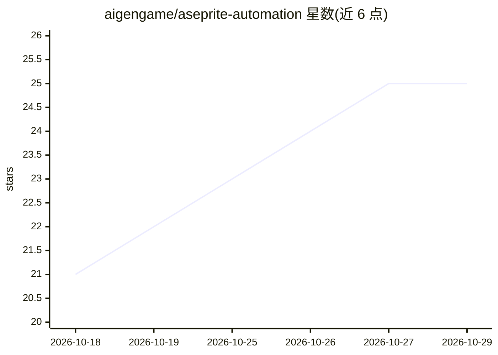

# aigengame/aseprite-automation

⭐ 25 · Python · MIT · 推送 2026-10-24 · [GitHub](https://github.com/aigengame/aseprite-automation) · 组织维护 · 中文 README

**让 AI agent 通过 CLI/Skill/MCP 操作 Aseprite 创建像素美术**

SPA 是一个 Python CLI 工具，以批处理方式驱动独立的 Aseprite 程序，提供精灵/图层/帧/cel/tag/slice 的创建与编辑、PNG 导入、绘制与滤镜、动画与运动曲线、调色板与 tileset 操作，并可导出 PNG/GIF/精灵表（含 JSON）与 tile 资产。面向在游戏资产流水线中使用 AI agent 的开发者，提供 CLI、Agent Skill、MCP server 三种接入方式；命令默认返回结构化 JSON，并带校验与帧比较能力。需单独安装 Aseprite 可执行文件，SPA 不捆绑该程序。

## 筛选速览

| 维度 | 判定 | 备注 |
|---|---|---|
| AI 角色 | `ai-ecosystem` | LLM/agent 周边工具 |
| 许可风险 | `permissive` | MIT |
| 部署形态 | `library` | 以包/库形式分发 |
| 模型依赖 | — | README 未给出锁定关系 |
| 硬件要求 | — | 无带数字的原话,不猜 |
| 安装摩擦 | `low` | 无编译、无系统依赖或容器化 |
| 成熟度 | — | 结构信号不足 |

## 能力要点

- CLI / Agent Skill / MCP server 三种 agent 接入方式
- 操作 Aseprite 原生图层、帧、cel、tag、tileset 并保留可编辑源文件
- 导出 PNG、GIF、精灵表（含 JSON）与 tile 资产
- plan check / plan run 支持多步编辑后一次性保存，命令返回结构化 JSON 校验结果

## 适用场景

- 让 AI agent 按指令生成和编辑游戏像素美术与动画资产
- 在资产流水线中批量创建、校验、导出精灵表和 tileset
- 通过 MCP 客户端以工具调用方式操作 Aseprite 资产

## 场景标签

`图像生成` · 领域:内容生成

## 证据(README 行号)

> L7: **Create, edit, verify, and export pixel art and sprite animations with AI agents.**
> L9: SPA brings Aseprite to your agent workflows through a CLI, Agent Skill, or MCP server.
> L51: - **Choose your agent connection.** Use shell commands, reusable Skill guidance,

## 星数曲线

2026-10-18 21 → 2026-10-29 25（+4）

---
*卡片 v1 · prompt 1.4 · 生成 2026-10-27 · 置信度 mid · 依据 README sha `be3adfea8a7f` · [字段定义](../../DATASET.md)*
