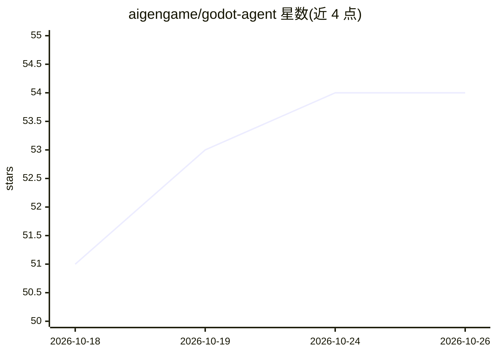

# aigengame/godot-agent

⭐ 54 · Python · MIT · 推送 2026-10-16 · [GitHub](https://github.com/aigengame/godot-agent) · [官网](https://aigengame.xyz/) · 组织维护 · 中文 README

**面向 AI agent 的 Godot 自动化 CLI：无头构建验证与运行时控制**

gda 是一个 Python 编写的 Godot 引擎自动化工具链，供 AI 编码 agent、shell 脚本与 CI 使用，通过 CLI、内置 Agent Skill 或 MCP server（gda-mcp，stdio 协议）三种途径暴露同一组操作。Headless 模式支持创建/编辑场景、节点、脚本、资源与着色器，编译校验、场景预检与导出构建；Live 模式通过每项目守护进程（gda-daemon）读取运行时场景树、模拟输入、捕获帧、收集日志与性能计数。命令输出结构化 JSON，提供 --schema 与类型化失败信息。要求 Python 3.13+ 与 Godot 4.4+（Live 需 4.6+）二进制。

## 筛选速览

| 维度 | 判定 | 备注 |
|---|---|---|
| AI 角色 | `ai-ecosystem` | LLM/agent 周边工具 |
| 许可风险 | `permissive` | MIT |
| 部署形态 | `desktop` | 安装包/桌面程序 |
| 模型依赖 | — | README 未给出锁定关系 |
| 硬件要求 | — | 无带数字的原话,不猜 |
| 安装摩擦 | `low` | 无编译、无系统依赖或容器化 |
| 成熟度 | — | 结构信号不足 |

## 能力要点

- Headless 模式：无编辑器插件即可创建场景/节点/脚本/资源并校验、导出
- Live 模式：守护进程读取运行时状态、模拟输入、捕获帧、采样性能
- CLI / Agent Skill / MCP server 三种接入途径共享同一操作面与结构化 JSON 结果
- MCP server 兼容前后两代协议，可注册到 Claude Code、Codex、Cursor

## 适用场景

- 让 AI 编码 agent 直接创建并验证 Godot 游戏项目
- 在 CI 中以无头方式校验 Godot 项目可构建性
- 通过 MCP 客户端驱动并检查运行中的游戏行为

## 场景标签

 · 领域:游戏开发/agent 工具链

## 证据(README 行号)

> L15: **Build and verify Godot projects with AI coding agents, shell scripts, and CI.**
> L16: `gda` provides Godot automation with headless validation as well as live runtime
> L17: inspection and control through a CLI, a bundled Agent Skill, or an MCP server,
> L161: `gda` provides one operation surface through three complementary access paths. Use the CLI,

## 星数曲线

2026-10-18 51 → 2026-10-26 54（+3）

---
*卡片 v1 · prompt 1.4 · 生成 2026-10-24 · 置信度 mid · 依据 README sha `d7c30eeb3342` · [字段定义](../../DATASET.md)*
