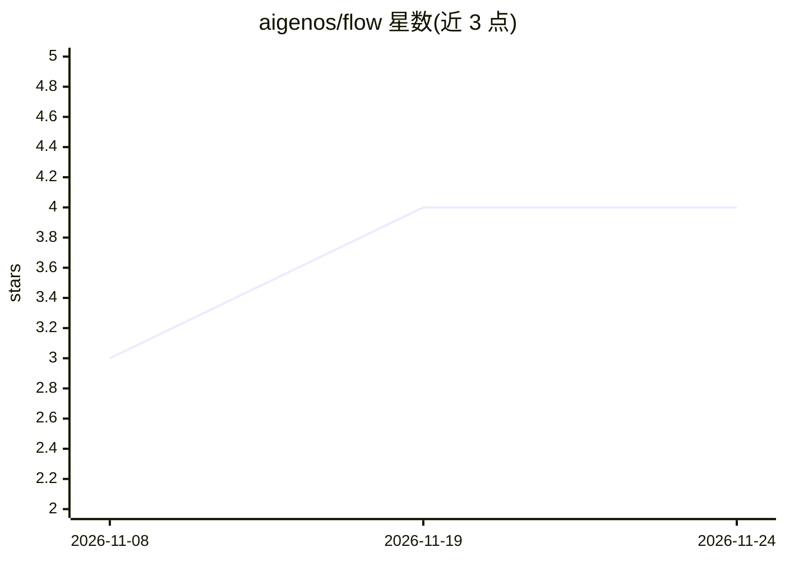

# aigenos/flow

⭐ 4 · Python · Apache-2.0 · 推送 2026-11-20 · [GitHub](https://github.com/aigenos/flow) · [官网](https://aigenos.io) · 组织维护

**为开发者提供确定性 agent 工作流引擎：LLM 只填字段，流程由文件控制**

aigenos/flow 是一个 Python/React 库，将业务流程写成 SKILL.md 文件，由引擎执行：模型只将用户输入转换为类型化字段，提问顺序、规则与工具调用由文件决定，写入类工具需先经 confirm 门控。提供 wrap_agent 包装既有 LangGraph agent，或 create_agent 直接作为 agent 运行；加载器在会话前做 fail-closed 校验，拒绝缺少确认步骤或引用缺失答案的文件。含 FastAPI 组件服务器（AG-UI/A2UI/MCP-UI 适配器）与 React 渲染器。需 Python 3.11+，演示中支付与预订为模拟。

## 筛选速览

| 维度 | 判定 | 备注 |
|---|---|---|
| AI 角色 | `ai-ecosystem` | LLM/agent 周边工具 |
| 许可风险 | `permissive` | Apache-2.0 |
| 部署形态 | `library` | 以包/库形式分发 |
| 模型依赖 | local-ok | 支持本地模型 |
| 硬件要求 | — | 无带数字的原话,不猜 |
| 安装摩擦 | `low` | 无编译、无系统依赖或容器化 |
| 成熟度 | — | 结构信号不足 |

## 能力要点

- SKILL.md 单文件定义流程：ask/say/do/confirm/chat 五类步骤，约 20 个关键词
- 加载时 fail-closed 校验：写入工具无 confirm、拼写错误等即拒绝加载
- 引擎构建确认内容并在调用时比对，输入变更则拒绝执行并重新询问
- 提供 PyPI 包、可选 FastAPI 服务器扩展与 npm React 渲染器

## 适用场景

- 在转账、退款、订票等 agent 工作流中要求写入操作经确认门控
- 为已有 LangGraph agent 增加流程治理层而不改动其工具与提示
- 生成可供合规人员审阅签字的流程说明文档
- 需要高金额操作转交合规人员在审批页处理的企业流程

## 场景标签

`Agent 框架` · 领域:Agent 开发

## 证据(README 行号)

> L15: aigenos/flow runs those workflows as steps in a `SKILL.md` file. The model
> L19: with LangGraph: put it in front of the agent you already have, or let it be the
> L195: |**aigenos-flow** (PyPI)|`pip install aigenos-flow`|The deterministic flow engine — SKILL.md skills, typed fields,

## 星数曲线

2026-11-08 3 → 2026-11-24 4（+1）

---
*卡片 v1 · prompt 1.4 · 生成 2026-11-21 · 置信度 high · 依据 README sha `6fcac60fb6a0` · [字段定义](../../DATASET.md)*
