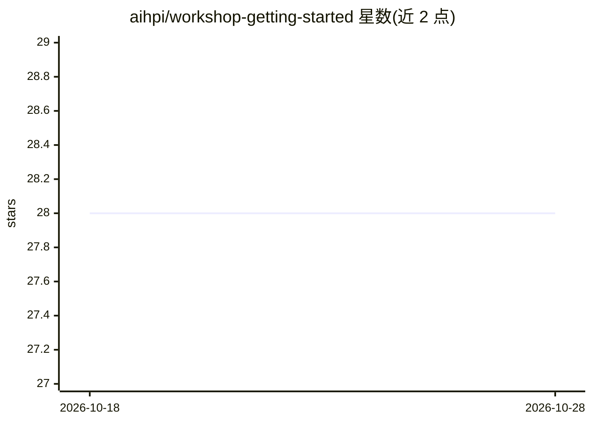

# aihpi/workshop-getting-started

⭐ 28 · Jupyter Notebook · 推送 2026-10-13 · [GitHub](https://github.com/aihpi/workshop-getting-started) · 组织维护

**AI 研讨会入门教程：开发环境与工具链准备指南**

由 AI Service Centre Berlin Brandenburg 维护的研讨会预备仓库：介绍参与者跨课程使用的开发工具与工作流（VSCode、Git、WSL、UV、Python、Jupyter、Ollama、Docker）。工作坊材料位于 03_workshop/，含议程、各工具指南、可在家复现的 Jupyter 笔记本与幻灯片。仓库另含一个示例聊天机器人（React 前端 + FastAPI 后端 + Ollama 集成），通过 docker-compose 在本地运行全栈，默认绑定 127.0.0.1，API 无鉴权。MIT 许可。

## 筛选速览

| 维度 | 判定 | 备注 |
|---|---|---|
| AI 角色 | `ai-knowledge` | 知识聚合/清单类 |
| 许可风险 | `none` | — |
| 部署形态 | `None` |  |
| 模型依赖 | local-ok | 支持本地模型 |
| 硬件要求 | — | 无带数字的原话,不猜 |
| 安装摩擦 | `low` | 无编译、无系统依赖或容器化 |
| 成熟度 | — | 结构信号不足 |

## 能力要点

- 覆盖 8 种开发工具的工作坊指南与 Jupyter 笔记本
- 示例聊天机器人：React 前端 + FastAPI 后端 + Ollama 集成
- docker-compose 一键本地运行全栈，端口默认绑定 127.0.0.1

## 适用场景

- 研讨会前配置本地 AI 开发环境
- 在家中复现工作坊的笔记本练习
- 参考一个 Ollama 本地聊天机器人的完整栈示例

## 场景标签

`教程课程` · 领域:学习与行业

## 证据(README 行号)

> L3: This repository hosts the **Getting Started** workshop offered by the AI Service Centre Berlin Brandenburg. It intro
> L15: This repository also includes a small chatbot application that demonstrates what you can build once your environmen

## 星数曲线

2026-10-18 28 → 2026-10-28 28（+0）

---
*卡片 v1 · prompt 1.4 · 生成 2026-10-26 · 置信度 high · 依据 README sha `6eb3bc3690df` · [字段定义](../../DATASET.md)*
