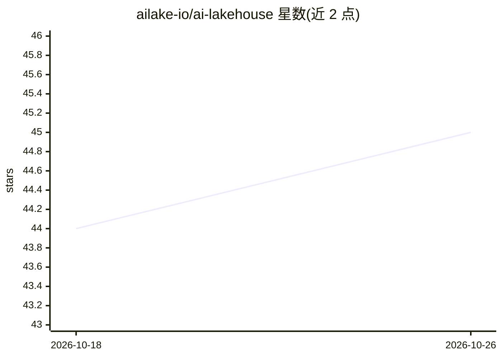

# ailake-io/ai-lakehouse

⭐ 45 · Rust · NOASSERTION · 推送 2026-10-09 · [GitHub](https://github.com/ailake-io/ai-lakehouse) · 组织维护

**Rust 编写的向量化湖仓格式：单文件融合 Parquet 表数据、向量与 HNSW 索引**

基于 Apache Iceberg Spec v2/v3 的存储格式，以 Rust 实现，将表格数据、向量嵌入与 HNSW 索引写入单个扩展 Parquet 文件，置于 S3 层，ACID 事务由 Iceberg 快照隔离提供。标准 Parquet 读取器（Spark/Trino/DuckDB 等）无需插件即可读取；HNSW 索引存于文件 footer。支持几何裁剪、F16/IVF-PQ 量化、BM25 与全文混合检索、多模态 RRF。运行时通过动态 FFI 加载 cuBLAS/hipBLAS，CPU 环境回退到 SIMD。面向数据平台开发者，提供 Rust crate、Python 包与 JVM 插件。

## 筛选速览

| 维度 | 判定 | 备注 |
|---|---|---|
| AI 角色 | `ai-ecosystem` | LLM/agent 周边工具 |
| 许可风险 | `none` | NOASSERTION |
| 部署形态 | `self-host` | docker 或自建部署 |
| 模型依赖 | — | README 未给出锁定关系 |
| 硬件要求 | `cpu-ok` | |
| 安装摩擦 | `low` | 无编译、无系统依赖或容器化 |
| 成熟度 | — | 结构信号不足 |

## 能力要点

- 表格数据、向量与 HNSW 索引共存于单个 Iceberg 兼容文件
- 标准 Parquet/Iceberg 读取器无插件读取，索引藏于 footer
- 几何文件裁剪在 I/O 前消除 95–99% 对象
- 运行时动态加载 cuBLAS/hipBLAS，同一二进制 CPU(CUDA/ROCm 自适应

## 适用场景

- 在既有 Iceberg/Parquet 湖仓上叠加向量检索，避免独立向量数据库
- 构建带 ACID 事务、时间旅行与回滚的 RAG 数据层
- 在 Spark/Trino/Flink 流水线中统一表格查询与向量搜索
- S3 大规模向量负载下用量化与裁剪控制存储与读取成本

## 场景标签

`向量数据库` · 领域:知识与检索

## 证据(README 行号)

> L12: Vector-native Lakehouse format built on Apache Iceberg Spec v2/v3, written in Rust.
> L14: **Single self-contained file**: tabular data, embeddings, and HNSW index live together in one Parquet-extended file
> L22: **Iceberg-compatible by spec, not by convention.** Standard Parquet readers (Spark, Trino, DuckDB, Athena, Snowflak

## 星数曲线

2026-10-18 44 → 2026-10-26 45（+1）

---
*卡片 v1 · prompt 1.4 · 生成 2026-10-25 · 置信度 high · 依据 README sha `2b7556147588` · [字段定义](../../DATASET.md)*
