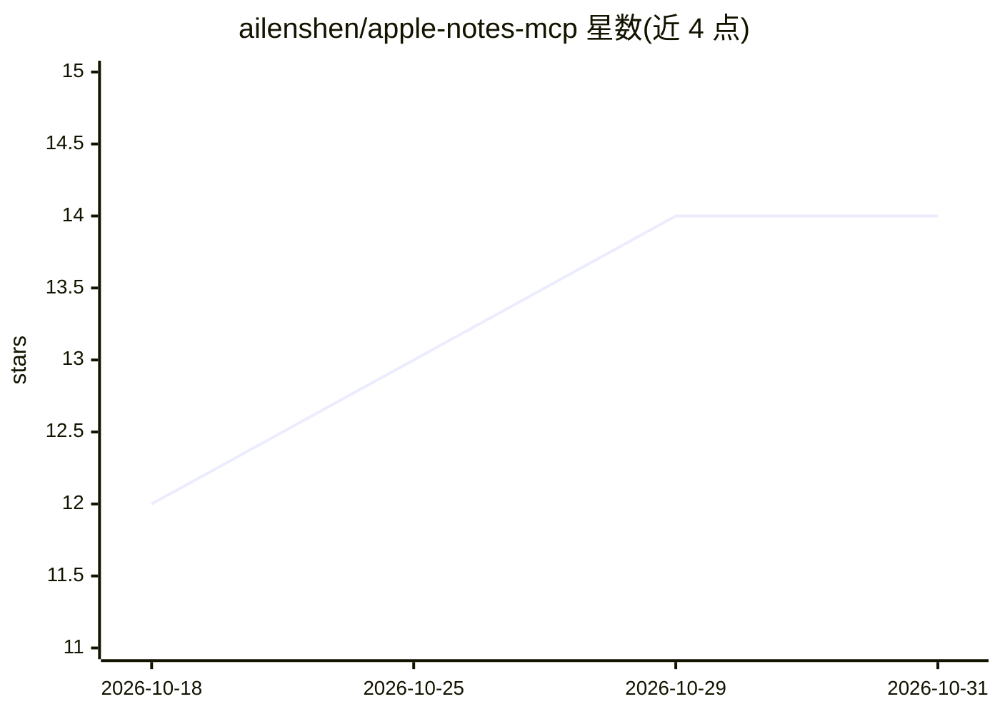

# ailenshen/apple-notes-mcp

⭐ 14 · Swift · MIT · 推送 2026-10-16 · [GitHub](https://github.com/ailenshen/apple-notes-mcp) · 个人维护 · 中文 README

**让 Claude 直接读写 Apple Notes 的 MCP 服务器**

在 macOS 上运行的 MCP 服务器，通过 Notes 自身的数据框架与编辑对象，让 Claude 等 MCP 客户端以 Apple Notes 原生格式读写笔记：支持标题、清单、表格、高亮等样式，附件可读，写回时只改动差异部分并请求 iCloud 同步；写入前有冲突检测与备份。需 macOS 26+、Node.js 24+，通过 npx 安装并授予磁盘访问与自动化权限。附件不可增删、文件夹不可移动等为已知限制。

## 筛选速览

| 维度 | 判定 | 备注 |
|---|---|---|
| AI 角色 | `ai-ecosystem` | LLM/agent 周边工具 |
| 许可风险 | `permissive` | MIT |
| 部署形态 | `library` | 以包/库形式分发 |
| 模型依赖 | locked-api |  |
| 硬件要求 | — | 无带数字的原话,不猜 |
| 安装摩擦 | `low` | 无编译、无系统依赖或容器化 |
| 成熟度 | — | 结构信号不足 |

## 能力要点

- 保留 Apple Notes 原生格式的差异式编辑
- 10 个工具覆盖搜索、读写、移动、文件夹管理与导出
- 写入前冲突检测与每次变更前备份
- 附件（图片/扫描/PDF/视频）读取

## 适用场景

- 用对话整理、勾选和补充我的购物清单与会议笔记
- 把 Apple Notes 里的内容变成 AI 可用的数据源
- 批量导出文件夹归档或为笔记生成一行描述

## 场景标签

`知识库管理` · 领域:知识与检索

## 证据(README 行号)

> L7: apple-notes-mcp MCP server
> L13: **Requires:** macOS 26 (Tahoe) or later, Node.js 24+, and Claude Code, Claude Desktop (including Cowork and Code se

## 星数曲线

2026-10-18 12 → 2026-10-31 14（+2）

---
*卡片 v1 · prompt 1.4 · 生成 2026-10-31 · 置信度 high · 依据 README sha `1367f8b63823` · [字段定义](../../DATASET.md)*
