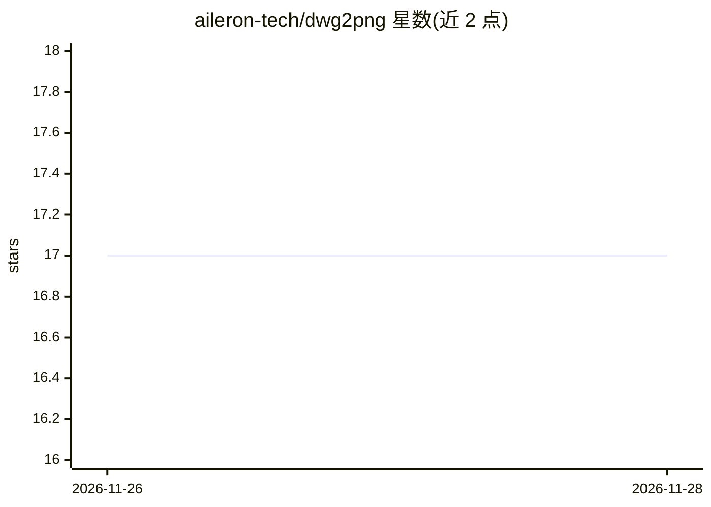

# aileron-tech/dwg2png

⭐ 17 · Rust · 推送 2026-11-24 · [GitHub](https://github.com/aileron-tech/dwg2png) · 组织维护

**把 DWG/DXF/SVG 图纸转成供 RAG 与视觉模型使用的可检索文件**

一个命令行工具，读取 DWG（R13-R2018）、DXF 与 UTF-8 SVG 图纸，输出位置标注的文本层（labels/*.json，像素坐标+图层+颜色，无 OCR）、结构化索引（json/*.json）、可读瓦片（tiles/*.png）与整页 PNG/SVG 预览。单二进制或容器分发，离线 CPU 运行，无 FFI 与外部 CAD 引擎。提供 MCP 服务器与 Apify Actor 伴随程序、agent skill 安装入口。局限包括 Hatch/尺寸标注等不渲染、SHX 字体替换、线宽恒定约 1px。

## 筛选速览

| 维度 | 判定 | 备注 |
|---|---|---|
| AI 角色 | `ai-enhanced` | 去掉 AI 部分产品仍成立 |
| 许可风险 | `none` | — |
| 部署形态 | `self-host` | docker 或自建部署 |
| 模型依赖 | — | README 未给出锁定关系 |
| 硬件要求 | — | 无带数字的原话,不猜 |
| 安装摩擦 | `low` | 无编译、无系统依赖或容器化 |
| 成熟度 | — | 结构信号不足 |

## 能力要点

- 无 OCR 的原生文本提取，每条标注带像素坐标、页码、图层与颜色
- ~1500px 可读瓦片配合 per-tile 标签 JSON，供 VLM 输入
- 支持文本 RAG 与多模态 RAG 两条检索通道，输出可引用具体标注位置
- 纯 Rust 单二进制或 81MB 容器，离线 CPU 运行，提供 MCP 服务器与 agent skill

## 适用场景

- 把工程图纸库批量转成可全文检索与嵌入的数据
- 让 VLM 读取大幅 CAD 图纸上的细小标注
- 为多模态 RAG 构建带位置引用的图纸语料

## 场景标签

`文档解析` `RAG` · 领域:知识与检索

## 证据(README 行号)

> L3: **Drawing ingestion for AI applications.** dwg2png turns DWG, DXF and SVG drawings into files for RAG, full-text sea
> L30: ## Use in AI pipelines (RAG, search, VLM)
> L23: It ships as a single pure-Rust binary or an 81 MB container, and runs offline

## 星数曲线

2026-11-26 17 → 2026-11-28 17（+0）

---
*卡片 v1 · prompt 1.4 · 生成 2026-11-26 · 置信度 mid · 依据 README sha `1373b4684aac` · [字段定义](../../DATASET.md)*
