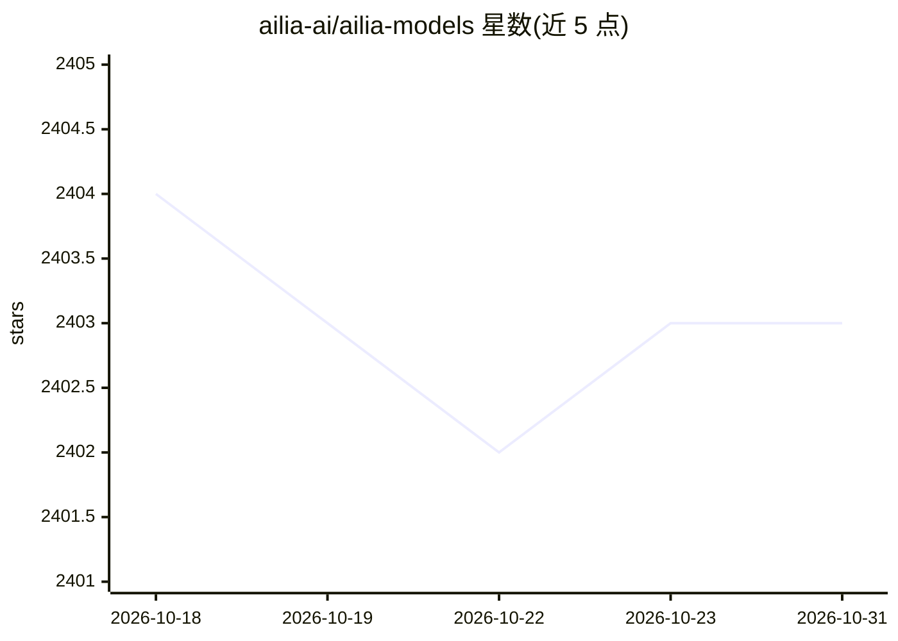

# ailia-ai/ailia-models

⭐ 2,403 · Python · NOASSERTION · 推送 2026-10-30 · [GitHub](https://github.com/ailia-ai/ailia-models) · 组织维护

**面向 ailia SDK 的预训练模型集合，419 个模型统一 CLI 运行**

ailia SDK 官方维护的预训练模型集合，收录 419 个模型，覆盖目标检测、语音识别、图像生成、LLM、姿态估计、超分辨率等类别。所有模型通过相同 CLI 方式运行：无需参数，权重自动下载。依赖 ailia SDK（跨平台推理 SDK，支持 Windows/Mac/Linux/iOS/Android/Jetson/Raspberry Pi，Vulkan/Metal GPU 加速）。安装方式为 pip 安装 ailia 后克隆本仓库运行模型脚本，另提供 Google Colaboratory 环境。

## 筛选速览

| 维度 | 判定 | 备注 |
|---|---|---|
| AI 角色 | `ai-native` | 本体是模型或模型工具 |
| 许可风险 | `none` | NOASSERTION |
| 部署形态 | `library` | 以包/库形式分发 |
| 模型依赖 | — | README 未给出锁定关系 |
| 硬件要求 | — | 无带数字的原话,不猜 |
| 安装摩擦 | `low` | 无编译、无系统依赖或容器化 |
| 成熟度 | — | 结构信号不足 |

## 能力要点

- 419 个预训练模型，覆盖检测、语音、图像生成、LLM 等类别
- 统一 CLI：无需参数，权重自动下载
- 支持 Python 原型后经 Unity/Kotlin/C++/Flutter/Rust 等绑定部署

## 适用场景

- 用统一命令快速试跑各类预训练模型
- 为 ailia SDK 应用选型并原型验证模型
- 在 Colab 中体验模型效果

## 场景标签

`目标检测` `图像视频处理` `语音识别` `图像生成` · 领域:内容生成

## 证据(README 行号)

> L6: The collection of pre-trained, state-of-the-art AI models: 419 models covering object detection, speech recognition,
> L10: Every model works the same way: no arguments needed, weights download automatically.

## 星数曲线

2026-10-18 2,404 → 2026-10-31 2,403（-1）

---
*卡片 v1 · prompt 1.4 · 生成 2026-10-21 · 置信度 high · 依据 README sha `5e8495d46108` · [字段定义](../../DATASET.md)*
