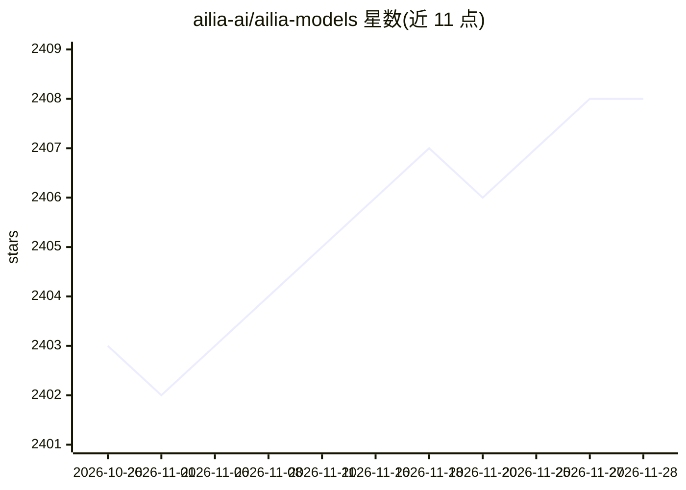

# ailia-ai/ailia-models

⭐ 2,408 · Python · NOASSERTION · 推送 2026-11-27 · [GitHub](https://github.com/ailia-ai/ailia-models) · 组织维护 · 中文 README

**428 个预训练 AI 模型合集，统一 CLI 运行推理**

面向 ailia SDK 的预训练模型集合，收录 428 个模型，覆盖目标检测、语音识别、图像生成、LLM、姿态估计、OCR、分割等数十个类别。每个模型以 Python 脚本形式提供，调用方式一致：无需参数，权重自动下载。安装 via pip3 install ailia 后 clone 仓库并安装 requirements.txt 即可运行。另有 Unity/Kotlin/C++/Flutter/Rust/JS 等多语言版本用于生产部署，模型本身为 Python 原型阶段。

## 筛选速览

| 维度 | 判定 | 备注 |
|---|---|---|
| AI 角色 | `ai-native` | 本体是模型或模型工具 |
| 许可风险 | `none` | NOASSERTION |
| 部署形态 | `library` | 以包/库形式分发 |
| 模型依赖 | — | README 未给出锁定关系 |
| 硬件要求 | — | 无带数字的原话,不猜 |
| 安装摩擦 | `low` | 无编译、无系统依赖或容器化 |
| 成熟度 | — | 结构信号不足 |

## 能力要点

- 428 个预训练模型统一 CLI 调用，权重自动下载
- 覆盖检测、分割、语音、扩散生成、LLM/VLM 等数十类任务
- 提供 Unity/C++/Kotlin/Flutter/Rust/JS 等多语言对应版本
- 基于跨平台 ailia SDK，支持 Vulkan/Metal GPU 加速

## 适用场景

- 在本地快速试用某个目标检测或分割模型
- 用 Python 原型验证后迁移到 Unity/C++ 生产部署
- 为项目挑选人脸识别、OCR、TTS 等现成模型方案

## 场景标签

`图像生成` `目标检测` `人脸识别` `OCR` · 领域:内容生成

## 证据(README 行号)

> L6: The collection of pre-trained, state-of-the-art AI models: 428 models covering object detection, speech recognition,
> L10: Every model works the same way: no arguments needed, weights download automatically.
> L81: ailia SDK is a cross-platform, high-speed inference SDK for AI. It supports Windows, Mac, Linux, iOS, Android, Jets

## 星数曲线

2026-10-26 2,403 → 2026-11-28 2,408（+5）

---
*卡片 v1 · prompt 1.4 · 生成 2026-11-23 · 置信度 high · 依据 README sha `f151c315417b` · [字段定义](../../DATASET.md)*
