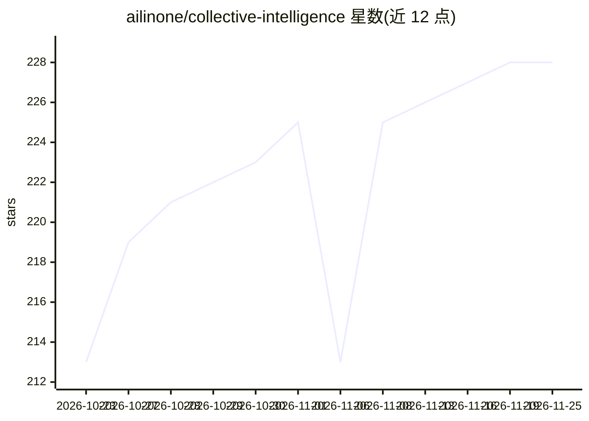

# ailinone/collective-intelligence

⭐ 228 · TypeScript · AGPL-3.0 · 推送 2026-11-23 · [GitHub](https://github.com/ailinone/collective-intelligence) · [官网](https://ailin.one) · 组织维护

**多模型协作引擎：按策略调度大量模型协同产出并留审计**

开源的集体智能引擎：索引 100,000+ 可发现模型标识，通过发现引擎自动吸收新模型，按 31 种注册策略（收敛共识、盲辩、专家面板、最佳 N 验证等）为每个请求实时组建模型团队，输出带完整决策溯源（ailin_metadata）。对外提供 OpenAI 兼容 API，支持每请求成本上限与租户隔离。许可证为 AGPL-3.0-or-later；文档自述部分层尚在成熟中，自有协调模型权重仍在开发。

## 筛选速览

| 维度 | 判定 | 备注 |
|---|---|---|
| AI 角色 | `ai-ecosystem` | LLM/agent 周边工具 |
| 许可风险 | `viral` | AGPL-3.0 |
| 部署形态 | `self-host` | docker 或自建部署 |
| 模型依赖 | local-ok | 支持本地模型 |
| 硬件要求 | — | 无带数字的原话,不猜 |
| 安装摩擦 | `low` | 无编译、无系统依赖或容器化 |
| 成熟度 | `idea` | |

## 能力要点

- 31 种注册协作策略与 ailin-auto 保守级联
- 持续发现引擎自动吸收新模型，无硬编码模型清单
- OpenAI 兼容 API，仅改 base_url 即可接入
- 每请求决策溯源与 max_cost 成本控制

## 适用场景

- 需要多模型交叉验证以提高可验证任务可靠性的应用
- 需要决策溯源与成本治理的企业 LLM 接入层
- 在单一服务商故障时保持请求可用的路由层

## 场景标签

`模型网关` `多智能体` · 领域:Agent 开发

## 证据(README 行号)

> L62: **This is not multi-model routing. This is not an API gateway. This is
> L206:     SDK[Any OpenAI SDK / curl base_url swap only] --> GW[OpenAI-compatible API]
> L211: *In text: a request enters through the OpenAI-compatible API from any OpenAI SDK or curl client (only the base_url

## 星数曲线

2026-10-23 213 → 2026-11-25 228（+15）

---
*卡片 v1 · prompt 1.4 · 生成 2026-11-25 · 置信度 mid · 依据 README sha `d15ca5d4f434` · [字段定义](../../DATASET.md)*
