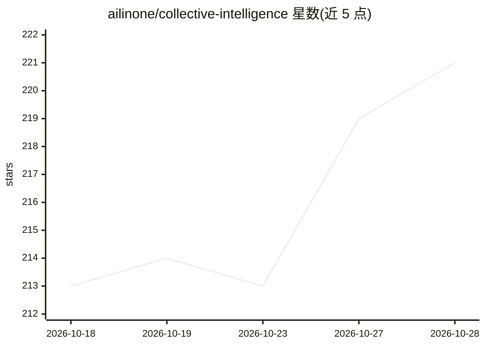

# ailinone/collective-intelligence

⭐ 222 · TypeScript · AGPL-3.0 · 推送 2026-10-26 · [GitHub](https://github.com/ailinone/collective-intelligence) · [官网](https://ailin.one) · 组织维护 · 中文 README

**让十万级 AI 模型协作的集体智能推理引擎**

Ailin¹ 是一个集体智能引擎：通过发现引擎索引 103,224 个模型、约 90 个 provider 集成，请求经 OpenAI 兼容 API 进入后由 32 种协调策略（共识、盲辩论、专家小组、成本级联等）组装模型团队、执行、仲裁并产出带完整溯源（ailin_metadata）的响应。面向需要跨多模型降低单点依赖、做成本治理与决策审计的开发者/企业。平台部分层级已生产可用，协调器权重等仍在开发中；多轮仲裁带来成本与延迟开销。

## 筛选速览

| 维度 | 判定 | 备注 |
|---|---|---|
| AI 角色 | `ai-ecosystem` | LLM/agent 周边工具 |
| 许可风险 | `viral` | AGPL-3.0 |
| 部署形态 | `self-host` | docker 或自建部署 |
| 模型依赖 | local-ok | 支持本地模型 |
| 硬件要求 | — | 无带数字的原话,不猜 |
| 安装摩擦 | `low` | 无编译、无系统依赖或容器化 |
| 成熟度 | `idea` | |

## 能力要点

- 103,224 个模型索引、约 90 个 provider 集成、32 种协调策略
- OpenAI 兼容 API，仅需改 base_url 即可接入
- 每次请求输出完整决策溯源与成本治理（max_cost、租户隔离）
- 基准的原始数据与复现脚本提交在仓库内

## 适用场景

- 把请求交给多模型集体协作以降低单模型单点依赖
- 企业流量上做成本上限、租户隔离与决策审计
- 对可客观验证的任务用共识+确定性校验器提升可靠性

## 场景标签

`模型网关` `多智能体` · 领域:Agent 开发

## 证据(README 行号)

> L200:     SDK[Any OpenAI SDK / curl base_url swap only] --> GW[OpenAI-compatible API]
> L205: *In text: a request enters through the OpenAI-compatible API from any OpenAI SDK or curl client (only the base_url

## 星数曲线

2026-10-18 213 → 2026-10-28 221（+8）

---
*卡片 v1 · prompt 1.4 · 生成 2026-10-22 · 置信度 high · 依据 README sha `67fba996e532` · [字段定义](../../DATASET.md)*
