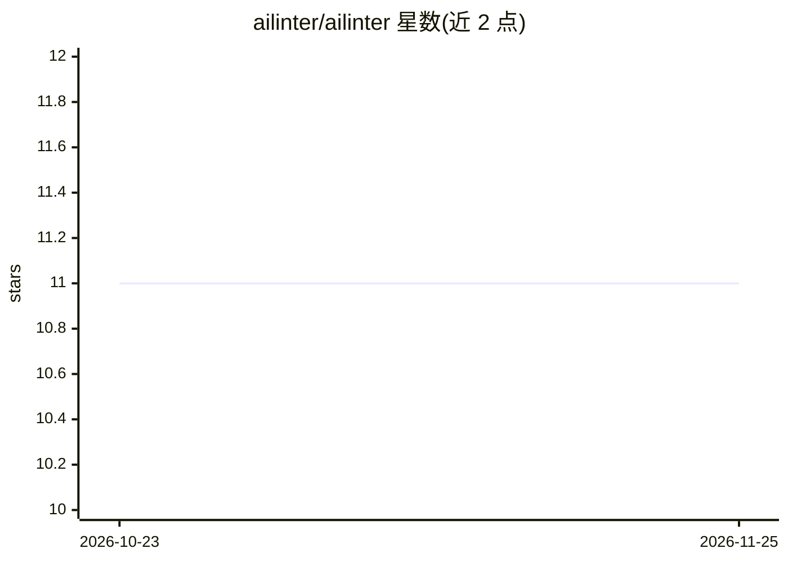

# ailinter/ailinter

⭐ 11 · Go · MIT · 推送 2026-11-14 · [GitHub](https://github.com/ailinter/ailinter) · [官网](https://ailinter.dev) · 个人维护

**为 AI 辅助开发提供代码质量、密钥与漏洞扫描的 linter 工具**

单个 30 MB Go 二进制的静态分析工具，提供三类扫描：20 类代码质量检测器（0–100 评分）、269+ 密钥检测规则（MCP 输出中密钥脱敏）、58 种漏洞模式。通过 CLI、VS Code 扩展、CI/CD（SARIF 输出）和原生 MCP 服务器（7 个工具）接入 AI 编码助手工作流，面向个人开发者、团队与安全工程师。离线运行，规则内嵌，默认无遥测，MIT 许可，跨 5 个平台分发。

## 筛选速览

| 维度 | 判定 | 备注 |
|---|---|---|
| AI 角色 | `ai-ecosystem` | LLM/agent 周边工具 |
| 许可风险 | `permissive` | MIT |
| 部署形态 | `self-host` | docker 或自建部署 |
| 模型依赖 | — | README 未给出锁定关系 |
| 硬件要求 | — | 无带数字的原话,不猜 |
| 安装摩擦 | `low` | 无编译、无系统依赖或容器化 |
| 成熟度 | — | 结构信号不足 |

## 能力要点

- 原生 MCP 服务器提供 7 个工具（analyze_code、scan_for_secrets 等）
- 269+ 密钥规则 + 150 条 gitleaks 回退规则，MCP 输出中密钥自动脱敏
- 20 类代码质量检测器，按文件语言做结构化分析，附 0–100 评分
- 支持 --diff 差异扫描与 GitHub Actions 质量门禁，SARIF 输出

## 适用场景

- 提交 AI 生成的代码前运行质量与安全扫描
- 团队为所有 AI PR 统一设置代码质量门禁
- 将扫描嵌入 MCP 兼容的 IDE 与 agent 流水线
- 扫描代码库中硬编码的云与 AI 服务密钥

## 场景标签

`代码审查` · 领域:编码与开发

## 证据(README 行号)

> L17: **One 30 MB binary. 269+ secret rules. 58 vulnerability patterns. 20 quality detectors. 7 MCP tools. VS Code extens
> L131: AILINTER is a native MCP (Model Context Protocol) server. Add it to any MCP-compatible AI assistant:
> L150: Works with **Claude Code, Cursor, OpenCode, Windsurf, Continue.dev, Cline, GitHub Copilot**, and any MCP-compatibl

## 星数曲线

2026-10-23 11 → 2026-11-25 11（+0）

---
*卡片 v1 · prompt 1.4 · 生成 2026-11-18 · 置信度 mid · 依据 README sha `814ec54bfada` · [字段定义](../../DATASET.md)*
