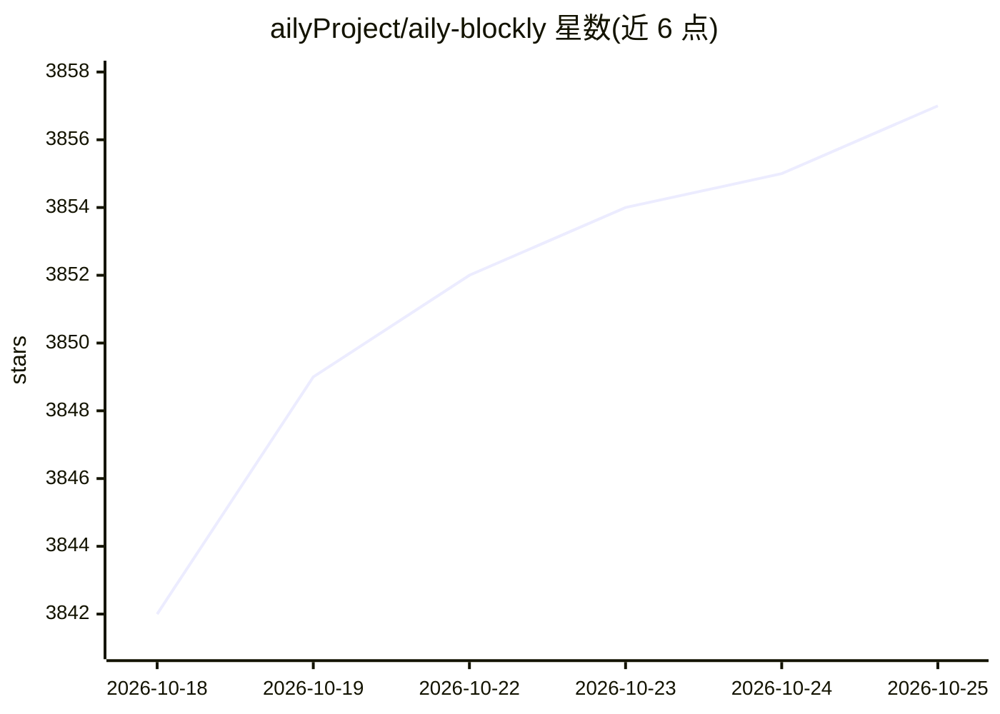

# ailyProject/aily-blockly

⭐ 3,857 · TypeScript · GPL-3.0 · 推送 2026-10-24 · [GitHub](https://github.com/ailyProject/aily-blockly) · [官网](https://aily.pro) · 组织维护 · 中文 README

**面向非专业用户的图形化硬件开发 IDE，AI 辅助编程**

基于 Blockly 的通用硬件开发环境（aily Project 子项目），支持 100+ 开发板/芯片、400+ 预置库，覆盖 Arduino、MicroPython、ESP32、STM32、RP2040、Nrf5x 等。AI 参与开发全流程：项目分析、方案推荐、接线图生成、代码生成、编译错误分析与调试建议，并可对缺失的 Blockly 库分析原生 Arduino/C/C++ 库生成适配。桌面端基于 Electron+Angular 构建，提供国内版与国际版下载。当前处于 alpha 阶段，作者声明不推荐用于量产固件开发，适合原型与教育场景。GPL 许可，禁止未授权销售。

## 筛选速览

| 维度 | 判定 | 备注 |
|---|---|---|
| AI 角色 | `ai-enhanced` | 去掉 AI 部分产品仍成立 |
| 许可风险 | `viral` | GPL-3.0 |
| 部署形态 | `None` |  |
| 模型依赖 | — | README 未给出锁定关系 |
| 硬件要求 | — | 无带数字的原话,不猜 |
| 安装摩擦 | `low` | 无编译、无系统依赖或容器化 |
| 成熟度 | `idea` | |

## 能力要点

- 支持 100+ 开发板/芯片与 400+ 预置库，按项目管理板卡包与工具链
- AI 参与全流程：项目分析、接线图生成、代码生成与编译错误分析
- AI 可分析原生 Arduino/C/C++ 库并生成 Blockly 适配
- 边缘-云端协同编译缓存缩短编译等待

## 适用场景

- 不懂代码的用户通过积木和自然语言做硬件原型
- 教育场景下的硬件编程教学
- 开发时让 AI 生成接线图并定位编译错误

## 场景标签

`代码生成` `编码 Agent` · 领域:编码与开发

## 证据(README 行号)

> L6: aily Blockly is the Blockly IDE under aily Project. In the early stage, it provides AI-assisted programming capabili
> L8: aily Blockly is not companion software for a single piece of hardware. It is a truly general-purpose hardware develo
> L29: 4. **AI-Native Support**

## 星数曲线

2026-10-18 3,842 → 2026-10-25 3,857（+15）

---
*卡片 v1 · prompt 1.4 · 生成 2026-10-20 · 置信度 high · 依据 README sha `ea48ec13218a` · [字段定义](../../DATASET.md)*
