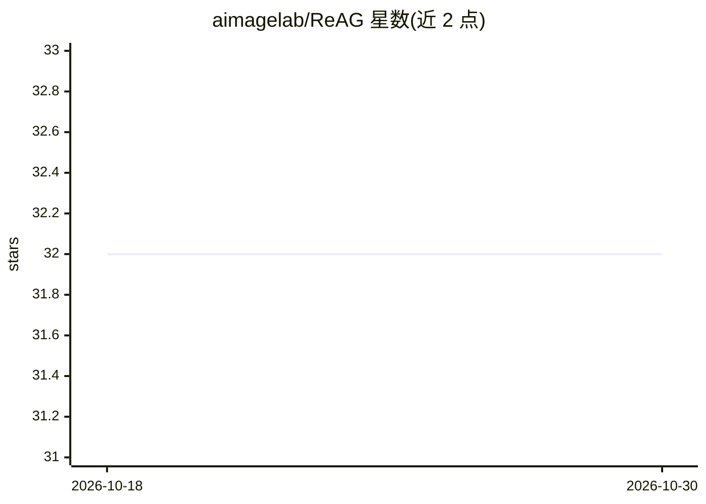

# aimagelab/ReAG

⭐ 32 · Python · 推送 2026-07-13 · [GitHub](https://github.com/aimagelab/ReAG) · [官网](https://aimagelab.github.io/ReAG/) · 组织维护

**面向知识型视觉问答的推理增强多模态 RAG 方法（CVPR 2026）**

ReAG 是针对知识型视觉问答（KB-VQA）的推理增强多模态 RAG 方法：结合粗粒度与细粒度检索，并用 Critic 模型在生成答案前过滤低质量段落；训练采用监督微调冷启动加强化学习以促成基于检索证据的显式推理。仓库提供推理代码与 Hugging Face 权重（3B/7B 生成器与 Critic），附 Infoseek 与 Encyclopedic-VQA 的评测数据、知识库与预构建 FAISS 索引（EVA-CLIP 嵌入）。推理脚本以 Slurm 作业形式提供，本地运行需去除 Slurm 前缀；EVQA 评测需单独的 TensorFlow 环境。

## 筛选速览

| 维度 | 判定 | 备注 |
|---|---|---|
| AI 角色 | `ai-native` | 本体是模型或模型工具 |
| 许可风险 | `none` | — |
| 部署形态 | `library` | 以包/库形式分发 |
| 模型依赖 | — | README 未给出锁定关系 |
| 硬件要求 | — | 无带数字的原话,不猜 |
| 安装摩擦 | `medium` | 含编译或系统依赖之一 |
| 成熟度 | — | 结构信号不足 |

## 能力要点

- 粗细粒度检索 + Critic 模型过滤低质量段落
- SFT 冷启动 + 强化学习的多阶段训练策略
- 提供 3B/7B 生成器与 Critic 权重（Hugging Face）
- 附预构建 FAISS 索引与两基准的打包评测数据

## 适用场景

- 在 Infoseek 与 Encyclopedic-VQA 上复现论文推理结果
- 研究者基于权重进行知识型 VQA 实验与消融
- 参考其 Critic 过滤机制构建多模态 RAG 流水线

## 场景标签

`RAG` `多模态` `科研工具` · 领域:知识与检索

## 证据(README 行号)

> L17: ReAG is a Reasoning-Augmented Multimodal RAG approach for Knowledge-based VQA. Standard retrieval-augmented methods
> L19: This repository contains the inference pipeline for **ReAG: Reasoning-Augmented Generation for Knowledge-based Visu

## 星数曲线

2026-10-18 32 → 2026-10-30 32（+0）

---
*卡片 v1 · prompt 1.4 · 生成 2026-10-26 · 置信度 mid · 依据 README sha `e949d72a7d9d` · [字段定义](../../DATASET.md)*
