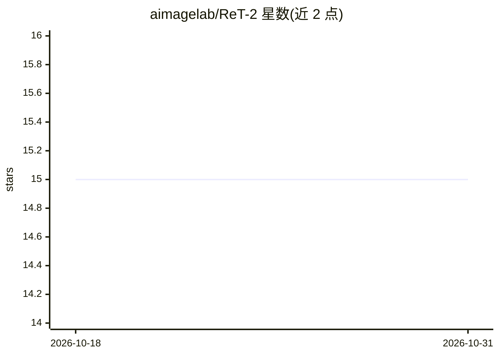

# aimagelab/ReT-2

⭐ 15 · Python · Apache-2.0 · 推送 2025-12-15 · [GitHub](https://github.com/aimagelab/ReT-2) · [官网](https://www.arxiv.org/abs/2509.08897) · 组织维护

**面向通用多模态检索的递归 Transformer 模型（TPAMI 2026）**

aimagelab 发布的多模态检索研究代码库：以递归增强的 Vision-and-Language Transformer 从图文段落提取嵌入，用 Faiss 内积索引完成检索，evaluate.py 覆盖 index/create_index/search 三阶段，支持单节点多 GPU 加速索引。可在 M2KR 与 M-BEIR 基准上复现论文结果，也可用于 RAG 视觉问答：先检索 Wikipedia 图文知识库，再由 LLaVA-MORE-8B 或 Qwen2.5-VL-7B-Instruct 生成回答。提供 conda/pip 安装流程与 SLURM 脚本，search 阶段仅支持单 GPU，E-VQA 评测依赖 TensorFlow 存在安装冲突的已知问题。

## 筛选速览

| 维度 | 判定 | 备注 |
|---|---|---|
| AI 角色 | `ai-native` | 本体是模型或模型工具 |
| 许可风险 | `permissive` | Apache-2.0 |
| 部署形态 | `library` | 以包/库形式分发 |
| 模型依赖 | — | README 未给出锁定关系 |
| 硬件要求 | — | 无带数字的原话,不猜 |
| 安装摩擦 | `medium` | 含编译或系统依赖之一 |
| 成熟度 | — | 结构信号不足 |

## 能力要点

- 递归 Transformer 提取多模态嵌入 + Faiss IndexFlatIP 检索
- evaluate.py 三阶段流程，index 阶段支持单节点多 GPU
- M2KR / M-BEIR 基准复现脚本与 SLURM sbatch 脚本
- RAG VQA 管线：检索 Wikipedia 图文 KB 后由 MLLM 生成回答

## 适用场景

- 复现论文中 M2KR、M-BEIR 基准上的检索实验
- 在自己的图文 JSONL 数据集上建索引并做检索
- 搭建图文知识库 RAG 视觉问答管线（InfoSeek / E-VQA）

## 场景标签

`语义搜索` `模型评测` `RAG` `多模态` · 领域:评测与运维

## 证据(README 行号)

> L1: ReT-2: Recurrence Meets Transformers for Universal Multimodal Retrieval
> L67: For the best VQA performance, we recommend using ReT-2 paired with ColBERT + SigLIP2 as the retrieval engine.
> L84: Run infoseek_rag_llava_more.sh to generate answers with LLaVA-MORE-8B, or infoseek_rag_qwen.sh to generate with Qwe

## 星数曲线

2026-10-18 15 → 2026-10-31 15（+0）

---
*卡片 v1 · prompt 1.4 · 生成 2026-10-30 · 置信度 mid · 依据 README sha `e3aefb491379` · [字段定义](../../DATASET.md)*
