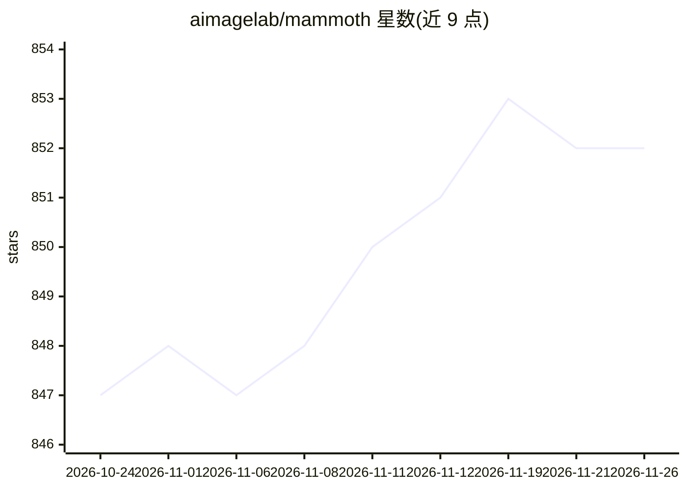

# aimagelab/mammoth

⭐ 852 · Python · MIT · 推送 2026-11-17 · [GitHub](https://github.com/aimagelab/mammoth) · 组织维护

**为持续学习研究者提供 70+ 方法与 23 个数据集的 PyTorch 基准框架**

基于 PyTorch 的持续学习研究框架，收录 70 余种方法与 23 个数据集，覆盖 Class-IL/Task-IL/Domain-IL/General Continual 等设定。模块化设计下可在 models/ 与 datasets/ 目录新增模型与数据集，模型超参以 models/config/ 下 YAML 管理，数据集自动下载。可通过 main.py 命令行运行实验，也可 pip install -e . 后作为库导入（尚未发布到 PyPI）。提供检查点续训、Ctrl+C 优雅中断保存、Hugging Face 工件上传脚本，并附 REPRODUCIBILITY.md 记录已验证模型的复现命令。

## 筛选速览

| 维度 | 判定 | 备注 |
|---|---|---|
| AI 角色 | `ai-native` | 本体是模型或模型工具 |
| 许可风险 | `permissive` | MIT |
| 部署形态 | `library` | 以包/库形式分发 |
| 模型依赖 | — | README 未给出锁定关系 |
| 硬件要求 | — | 无带数字的原话,不猜 |
| 安装摩擦 | `low` | 无编译、无系统依赖或容器化 |
| 成熟度 | — | 结构信号不足 |

## 能力要点

- 70+ 持续学习方法与 23 个数据集内置，含 DER/DER++ 官方实现
- 模块化扩展：models/ 与 datasets/ 目录添加新模型与数据集
- 检查点续训、SIGINT 优雅中断保存与自定义保存路径
- 提供上传脚本将检查点/缓存发布到 Hugging Face

## 适用场景

- 复现论文中持续学习方法的基准结果
- 在统一框架下实现并对比新的持续学习算法
- 在 MNIST/CIFAR/ImageNet-R/医学影像等序列数据集上评估遗忘程度

## 场景标签

`模型训练` `模型评测` `科研工具` · 领域:评测与运维

## 证据(README 行号)

> L8: # 🦣 Mammoth - A PyTorch Framework for Benchmarking Continual Learning
> L10: _Mammoth_ is built to streamline the development and benchmark of continual learning research. With **more than 70 
> L117: Mammoth currently supports **more than 70** models, with new releases covering the main competitors in literature.

## 星数曲线

2026-10-24 847 → 2026-11-26 852（+5）

---
*卡片 v1 · prompt 1.4 · 生成 2026-11-24 · 置信度 mid · 依据 README sha `8d2064a76d4c` · [字段定义](../../DATASET.md)*
