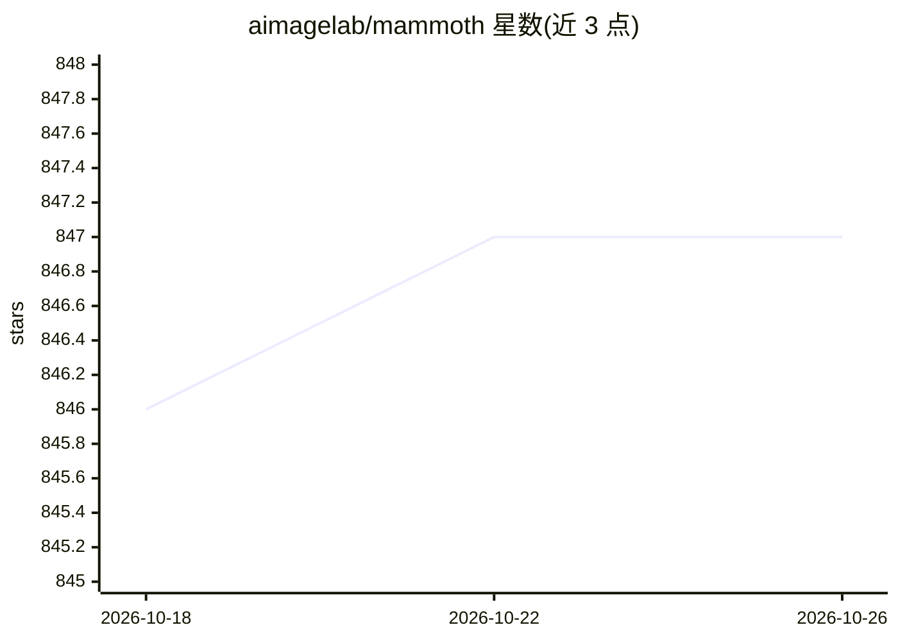

# aimagelab/mammoth

⭐ 847 · Python · MIT · 推送 2026-05-20 · [GitHub](https://github.com/aimagelab/mammoth) · 组织维护

**给持续学习研究者的 PyTorch 基准与实验框架**

基于 PyTorch 的持续学习（Continual Learning）研究框架，收录 70 余种方法与 23 个数据集（MNIST/CIFAR/ImageNet-R/医学与遥感等），通过 python main.py --model X --dataset Y 一行命令运行实验，支持 --model_config best 复现最优超参。结构模块化：新模型放 models/、新数据集放 datasets/ 即可扩展；可 pip install -e . 作为库导入（尚未发布 PyPI），并提供 Hugging Face 工件上传脚本、断点续训与 SIGINT 优雅停止。附 REPRODUCIBILITY.md 记录已验证模型结果。GEM 方法在 Windows 上不可用。

## 筛选速览

| 维度 | 判定 | 备注 |
|---|---|---|
| AI 角色 | `ai-ecosystem` | LLM/agent 周边工具 |
| 许可风险 | `permissive` | MIT |
| 部署形态 | `library` | 以包/库形式分发 |
| 模型依赖 | — | README 未给出锁定关系 |
| 硬件要求 | — | 无带数字的原话,不猜 |
| 安装摩擦 | `low` | 无编译、无系统依赖或容器化 |
| 成熟度 | — | 结构信号不足 |

## 能力要点

- 70+ 持续学习方法与 23 个数据集的统一基准
- 一行命令运行实验，--model_config best 加载最优超参
- 模块化扩展：models/ 与 datasets/ 目录即插即用
- Hugging Face 工件上传脚本与断点续训/优雅停止

## 适用场景

- 我需要在统一环境下对比多个持续学习方法的性能
- 我想复现论文中的最优超参配置结果
- 我想为新的持续学习方法和数据集快速搭建实验

## 场景标签

`模型评测` · 领域:评测与运维

## 证据(README 行号)

> L8: # 🦣 Mammoth - A PyTorch Framework for Benchmarking Continual Learning
> L10: _Mammoth_ is built to streamline the development and benchmark of continual learning research. With **more than 70 
> L117: Mammoth currently supports **more than 70** models, with new releases covering the main competitors in literature.

## 星数曲线

2026-10-18 846 → 2026-10-26 847（+1）

---
*卡片 v1 · prompt 1.4 · 生成 2026-10-21 · 置信度 mid · 依据 README sha `90c3abd98237` · [字段定义](../../DATASET.md)*
