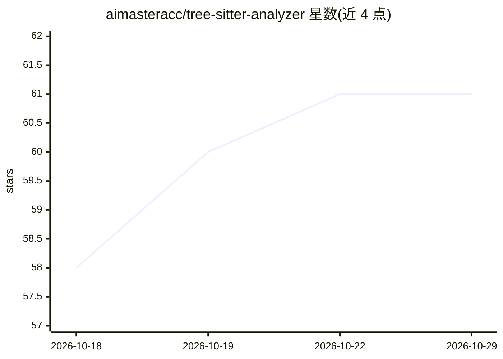

# aimasteracc/tree-sitter-analyzer

⭐ 61 · Python · MIT · 推送 2026-10-28 · [GitHub](https://github.com/aimasteracc/tree-sitter-analyzer) · 个人维护 · 中文 README

**本地代码智能 MCP 服务器：为 AI agent 提供跨语言调用图与结构化查询**

基于 tree-sitter 解析代码库并写入 SQLite + FTS5 索引，通过 8 个 MCP 工具与 CLI 向 AI 编程 agent 提供调用图、符号搜索、影响面（blast radius）、A–F 项目健康评分、安全编辑门禁与架构约束 DSL 等能力，全部本地运行、无遥测。支持 13 种语言，跨语言绑定按语言族门控。接入方式覆盖 Claude Code/Desktop、Cursor、Copilot、Cline、Continue、Roo Code，附自动安装脚本与 Dockerfile。需 Python 3.10+ 与 uv。

## 筛选速览

| 维度 | 判定 | 备注 |
|---|---|---|
| AI 角色 | `ai-ecosystem` | LLM/agent 周边工具 |
| 许可风险 | `permissive` | MIT |
| 部署形态 | `self-host` | docker 或自建部署 |
| 模型依赖 | — | README 未给出锁定关系 |
| 硬件要求 | — | 无带数字的原话,不猜 |
| 安装摩擦 | `low` | 无编译、无系统依赖或容器化 |
| 成熟度 | — | 结构信号不足 |

## 能力要点

- tree-sitter 解析 + SQLite/FTS5 索引，跨语言边按语言族门控
- 8 个 MCP 工具，标准 JSON 响应与 verdict 判定信封
- A–F 项目健康评分、safe-to-edit 门禁与架构约束 DSL
- 100% 本地运行，无遥测，无需 ripgrep/fd

## 适用场景

- AI 编程 agent 在改动前查询影响面与调用链
- 重构前做安全编辑检查与项目健康评估
- 本地为 agent 提供符号搜索与结构化代码查询

## 场景标签

 · 领域:开发工具/代码智能

## 证据(README 行号)

> L9: TSA indexes your codebase with tree-sitter and serves correct call graphs, symbol search, and structural queries to 
> L13: * **Built agent-native.** 8 MCP tools provide structured JSON output and verdict envelopes, with CLI access and cur
> L200: The 8 MCP tools expose indexed queries and direct source analysis.

## 星数曲线

2026-10-18 58 → 2026-10-29 61（+3）

---
*卡片 v1 · prompt 1.4 · 生成 2026-10-24 · 置信度 high · 依据 README sha `f5415f43f40c` · [字段定义](../../DATASET.md)*
