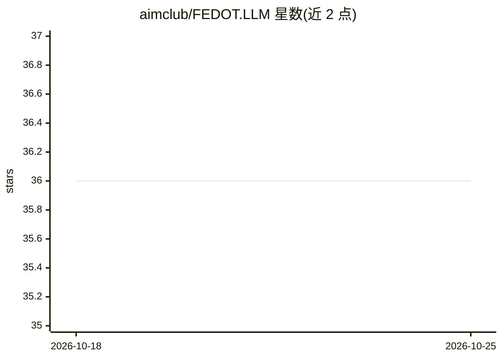

# aimclub/FEDOT.LLM

⭐ 36 · Python · BSD-3-Clause · 推送 2026-03-03 · [GitHub](https://github.com/aimclub/FEDOT.LLM) · [官网](https://fedot.readthedocs.io) · 组织维护

**结合 LLM 的自动机器学习原型：自动完成数据分析与建模**

FEDOT.LLM 是 ITMO 大学相关的下一代 AutoML 原型：将大语言模型与 FEDOT 自动化机器学习结合，用户通过 FedotAI 高层 API 的 ask 方法提交数据集与任务描述，即可启动 LLM 驱动的数据集分析与预测流水线。聊天模型经 litellm 接入多家 provider（文档列于 litellm 官网），需配置 LLM 与嵌入的 API key，可选 Langfuse 追踪。支持 uv/conda 源码安装、Docker Compose 与 Streamlit Web 界面，自身定位为 prototype。

## 筛选速览

| 维度 | 判定 | 备注 |
|---|---|---|
| AI 角色 | `ai-native` | 本体是模型或模型工具 |
| 许可风险 | `permissive` | BSD-3-Clause |
| 部署形态 | `self-host` | docker 或自建部署 |
| 模型依赖 | — | README 未给出锁定关系 |
| 硬件要求 | — | 无带数字的原话,不猜 |
| 安装摩擦 | `low` | 无编译、无系统依赖或容器化 |
| 成熟度 | `idea` | |

## 能力要点

- FedotAI 类高层 API：自然语言描述任务即启动分析与预测
- 聊天模型经 litellm 接入多 provider
- Docker Compose 快速启动与 Streamlit Web 界面
- 可选 Langfuse 追踪 LLM 调用

## 适用场景

- 用自然语言描述数据集任务，自动生成分析与预测
- 以竞赛数据目录为输入批量获取预测结果
- 在 Jupyter 或 Streamlit 中交互式使用 AutoML 流水线

## 场景标签

`数据分析` `Agent 框架` · 领域:Agent 开发

## 证据(README 行号)

> L9: FEDOT.LLM is an LLM-based prototype for next-generation AutoML. It combines the power of Large Language Models with 
> L161: FEDOT.LLM provides a high-level API with simple interface through FedotAI class. It can be used to start the whole

## 星数曲线

2026-10-18 36 → 2026-10-25 36（+0）

---
*卡片 v1 · prompt 1.4 · 生成 2026-10-25 · 置信度 high · 依据 README sha `e0917ad4aea0` · [字段定义](../../DATASET.md)*
