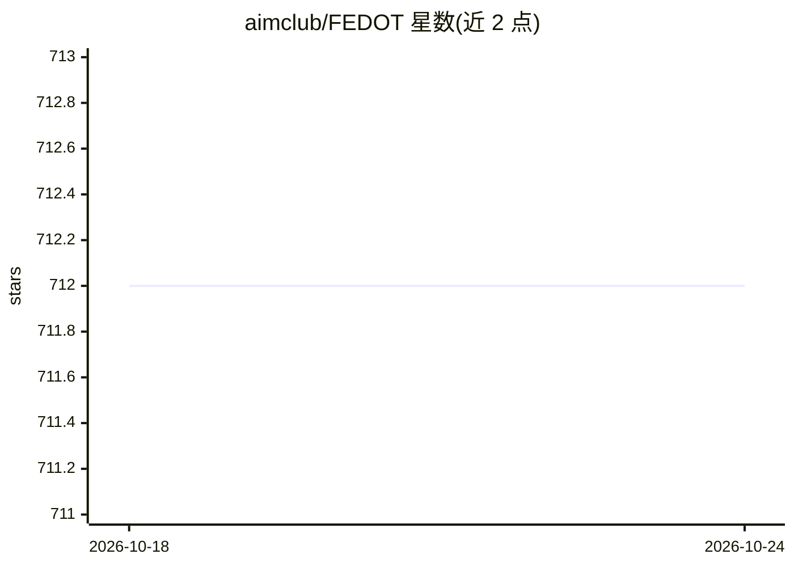

# aimclub/FEDOT

⭐ 712 · Python · BSD-3-Clause · 推送 2026-10-21 · [GitHub](https://github.com/aimclub/FEDOT) · [官网](https://fedot.readthedocs.io) · 组织维护 · 中文 README

**面向 AutoML 的自动机器学习流水线生成框架**

开源 AutoML 框架，基于进化算法与遗传编程自动生成机器学习流水线，以图结构管理预处理与模型模块的连接，支持二分类/多分类、回归、聚类与时间序列预测。集成 Scikit-learn、CatBoost、XGBoost 等库，支持超参数调优与自定义模型，流水线可导出为 JSON 或 ZIP 以保证可复现。由 ITMO 大学认知研究中心团队维护，提供 pip 安装、Docker 镜像与高层 fit/predict API，教程覆盖时间序列、多模态建模等场景。

## 筛选速览

| 维度 | 判定 | 备注 |
|---|---|---|
| AI 角色 | `ai-ecosystem` | LLM/agent 周边工具 |
| 许可风险 | `permissive` | BSD-3-Clause |
| 部署形态 | `library` | 以包/库形式分发 |
| 模型依赖 | — | README 未给出锁定关系 |
| 硬件要求 | — | 无带数字的原话,不猜 |
| 安装摩擦 | `low` | 无编译、无系统依赖或容器化 |
| 成熟度 | — | 结构信号不足 |

## 能力要点

- 进化算法自动生成复合 ML 流水线（图结构管理预处理与模型模块）
- 支持分类/回归/聚类/时间序列预测与多模态数据（表格/文本/图像）
- 流水线可导出为 JSON 或连同数据导出 ZIP 以复现实验
- 高层 API 提供 fit/predict/get_metrics 接口

## 适用场景

- 自动化构建分类或回归任务的机器学习流水线
- 时间序列预测与序列缺口填补
- 结合表格与文本的多模态建模任务
- 超参数自动调优与模型复杂度控制

## 场景标签

 · 领域:机器学习/AutoML

## 证据(README 行号)

> L34: **FEDOT** is an open-source framework for automated modeling and machine learning (AutoML) problems. This framework
> L36: It provides automatic generative design of machine learning pipelines for various real-world problems. The core of 
> L43: The project is maintained by the research team of the Natural Systems Simulation Lab, which is a part of the `Natio

## 星数曲线

2026-10-18 712 → 2026-10-24 712（+0）

---
*卡片 v1 · prompt 1.4 · 生成 2026-10-21 · 置信度 high · 依据 README sha `38cdfaed0285` · [字段定义](../../DATASET.md)*
