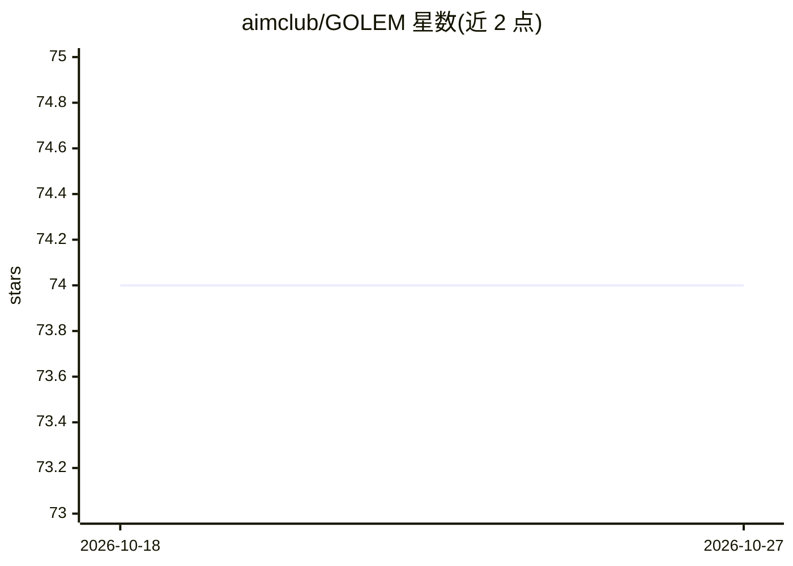

# aimclub/GOLEM

⭐ 74 · Python · BSD-3-Clause · 推送 2026-09-30 · [GitHub](https://github.com/aimclub/GOLEM) · [官网](https://thegolem.readthedocs.io) · 组织维护

**面向图结构模型的进化优化与学习框架**

ITMO 大学支持的通用 AI 框架，用元启发式（主要是进化）方法对图结构模型做联合优化：图结构与节点属性同时优化，支持多目标、带约束优化与任意领域扩展。适用于梯度方法难以处理的组合型或多冲突目标问题，可表示为有向图且有适应度函数的任务均可使用。已在 FEDOT（AutoML 流水线搜索）、BAMT（贝叶斯网络结构搜索）、EPDE、GEFEST 等框架中应用。通过 pip 安装，提供优化历史、模型序列化与可视化。

## 筛选速览

| 维度 | 判定 | 备注 |
|---|---|---|
| AI 角色 | `ai-ecosystem` | LLM/agent 周边工具 |
| 许可风险 | `permissive` | BSD-3-Clause |
| 部署形态 | `library` | 以包/库形式分发 |
| 模型依赖 | — | README 未给出锁定关系 |
| 硬件要求 | — | 无带数字的原话,不猜 |
| 安装摩擦 | `low` | 无编译、无系统依赖或容器化 |
| 成熟度 | — | 结构信号不足 |

## 能力要点

- 图结构与节点属性的联合进化优化
- 多目标与带领域约束的优化支持
- 优化历史记录、模型序列化与可视化工具
- 被 FEDOT/BAMT/EPDE/GEFEST 等框架用作底层优化引擎

## 适用场景

- 为 AutoML 做最优 ML 流水线结构搜索
- 贝叶斯网络或神经架构的结构学习
- 物理模型（桁架结构等）的几何设计与微分方程发现

## 场景标签

 · 领域:AI 框架/图优化

## 证据(README 行号)

> L14: GOLEM is an open-source AI framework for optimization and learning of structured graph-based models with meta-heuri
> L52: - Automatic Machine Learning (AutoML) with optimal ML pipelines search in `FEDOT framework <https://github.com/aimc

## 星数曲线

2026-10-18 74 → 2026-10-27 74（+0）

---
*卡片 v1 · prompt 1.4 · 生成 2026-10-24 · 置信度 high · 依据 README sha `fd1baf6456b9` · [字段定义](../../DATASET.md)*
